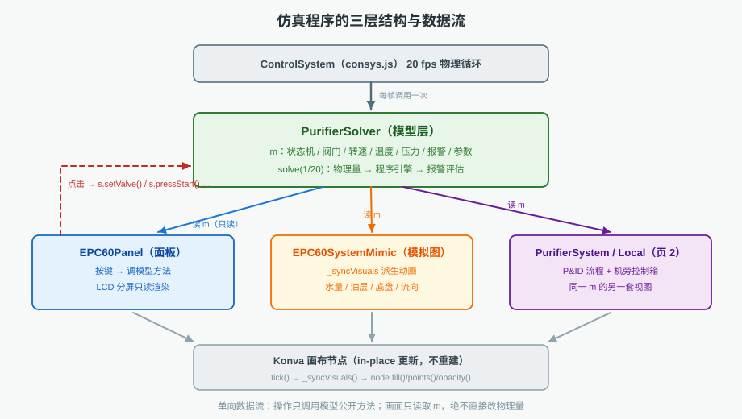
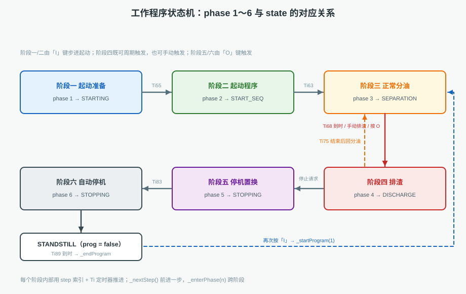
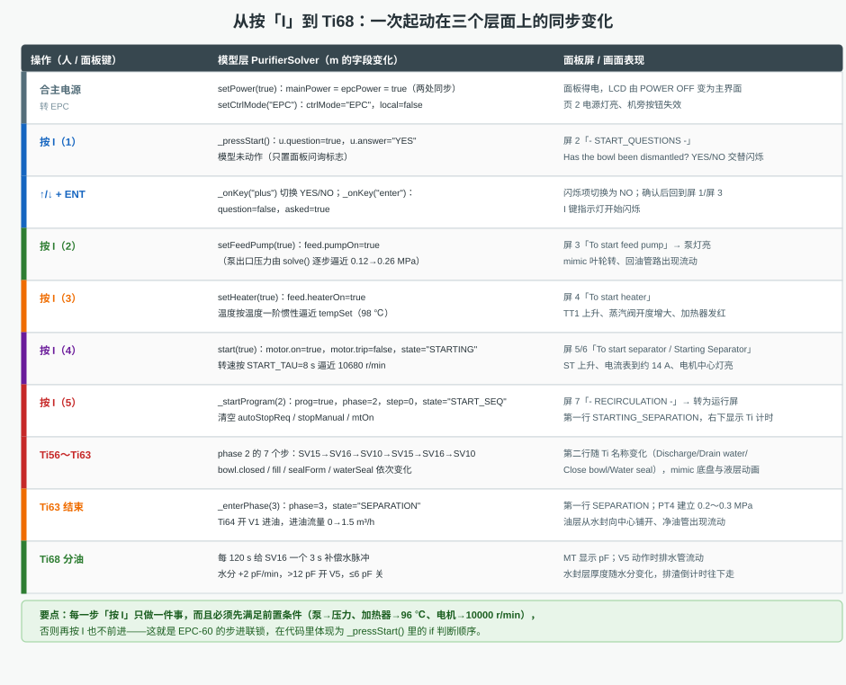

# 分油机仿真程序工作原理分析

> 本文面向两类读者：想搞清"这个仿真到底怎么算出来的"的教师/学员，以及后续要维护扩展本工程的开发者。文中引用的行号基于当前版本：`tools/PurifierSolver.js`（1754 行）、`components/EPC60Panel.js`（978 行）、`components/EPC60SystemMimic.js`（977 行）。

---

## 一、三层架构：谁在算、谁在画、谁在点

本工程的分油机仿真由三个文件构成一条清晰的分工链：

| 文件 | 角色 | 职责 | 绝不做什么 |
|------|------|------|-----------|
| `PurifierSolver.js` | **模型层** | 保存全部物理量与程序状态；每帧推演转速、温度、压力、流量、液位、报警；执行 EPC-60 的六阶段程序 | 不画图、不读 DOM |
| `EPC60Panel.js` | **面板层** | 把模型翻译成 LCD 文字与指示灯；把按键转成模型方法调用 | 不自己算物理量、不自己推进时序 |
| `EPC60SystemMimic.js` | **画面层** | 把 `m` 翻译成 P&ID 动画（液层、底盘、流向、读数） | 不改 `m` 的物理字段 |



### 1.1 每帧发生了什么

`consys.js` 的物理循环以 **20 fps**（`setTimeout` 自调度，间隔 50 ms）运行，每帧依次：

```js
// consys.js ≈ 1004
if (this.purifierSolver) this.purifierSolver.solve(1 / 20);   // ① 先算
...
this._tickAll(1 / 20);                                        // ② 再画
```

`_tickAll()` 遍历所有需要动画的组件，逐个调用 `comp.tick(dt)`；各组件（面板、模拟图、流程页）在 `tick()` 里只做一件事——**读 `m` 并刷新自己的 Konva 节点**。

所以整条链路是严格串行的：

```
按键/鼠标 → 组件方法 → solver 公开方法（改 m） → [下一帧] solve() 推演 → tick() 渲染
```

### 1.2 两条"单向"约束

1. **操作只能调用模型的公开方法**（`setValve()`、`pressStart()`、`setFault()` …），不允许组件直接写 `m.bowl.speed = 10000`。这样做的好处是：所有副作用（联锁、报警、状态迁移）都集中在模型里，界面永远只是"显示"。
2. **画面只读 `m`**。模拟图里那圈流动的虚线、慢慢长厚的水封层、变形的排渣底盘，全部是**每帧从 `m` 重新算出来的派生量**，不是各自维护的状态。这样即使 `m` 被重置（`resetAll()`），画面下一帧就自动归零，不会出现"画面和模型不一致"。

---

## 二、PurifierSolver.js 逐段精读

### 2.1 文件头与工具函数（1～22 行）

```js
const clamp = (v, lo, hi) => Math.max(lo, Math.min(hi, v));
const expApproach = (cur, target, tau, dt) => cur + (target - cur) * (1 - Math.exp(-dt / Math.max(0.001, tau)));

const RATED_SPEED = 10680;
const MIN_SPEED = 60;
const START_TAU = 8;           // 升速时间常数：约 25 s 到额定
const STOP_TAU = 6;            // 停机时间常数
const TEMP_TAU = 5.5;          // 升温时间常数
const COOL_TAU = 90;           // 自然降温时间常数
```

`expApproach()` 是全文最重要的一个函数：它实现**一阶惯性环节** `y(t) = target + (y₀ − target)·e^(−t/τ)`。传进去的 `tau` 决定"多久能到"，`dt` 决定"这一帧走多远"。所有连续量（转速、温度、压力、流量、水分）都用它推演，因此不会出现突变，也不会因为帧率变化而失真。

`MIN_SPEED = 60 r/min` 是"算静止"的门槛：低于它直接置 0，避免指数曲线永远逼近却到不了。

### 2.2 数据模型 createModel()（24～130 行）

整个仿真只有一个数据结构——一个普通对象 `m`。它是"唯一真相源"，可以按用途分成八组：

| 分组 | 关键字段 | 说明 |
|------|---------|------|
| 电源与模式 | `epcPower / mainPower / local / ctrlMode` | `ctrlMode` 为 `HAND / EPC / AUTO`，`local` 是其布尔化 |
| 状态机 | `state / stateTime` | `STANDSTILL / STARTING / START_SEQ / STANDBY / SEPARATION / DISCHARGE / STOPPING` |
| 程序指针 | `prog / phase / step / timerName / timerT` | 六阶段 + 阶段内步号 + 当前 Ti 定时器 |
| 分离筒 | `bowl.speed / closed / waterSeal / fill / sealForm / opWater / discharge / sealedOnce` | 物理与"可视化用"字段混在一起，见 4.3 |
| 三路工艺 | `feed / oil / water` | 进油、净油、工作水（含 `sv10/sv15/sv16/drain`） |
| 排渣柜 | `sludge.tank / count / nextIn / pumpOn` | 液位、次数、倒计时 |
| 报警 | `alarms / alarmLog / alarmActive` | 活动报警 + 历史记录 |
| 参数 | `params.*` | 分离温度、排渣间隔、各 Ti 时长、振动阈值… |

值得注意的三个"派生开关"：

- `bowl.sealedOnce`：是否**曾经**密封过。用来避免"升速阶段底盘本来就开着"被误判成排渣口开启。
- `feed.v1Return`：V1 是否处于回流位。它是**结果**字段，每帧由 `valveOpen` 反推（见 2.6 第 13 步）。
- `oil.mtOn`：水分检测是否投入。Ti65 之前恒为 `false`，画面显示 0.0。

### 2.3 电源、模式与阀门（133～410 行）

**电源同步**（157～200）是本工程后面加的一条"便利"逻辑：

```js
setPower(on, source = 'main') {
    if (m.mainPower === on && m.epcPower === on) return;
    m.mainPower = on;
    m.epcPower = on;                 // 机旁主电源与面板电源合一
    if (!on) { ...停电联锁... } else { if (m.ctrlMode === 'AUTO' && !m.prog) this._startProgram(1); }
}
setMainPower / setEpcPower / toggleMainPower / toggleEpcPower 都转调它
```

`source` 参数只影响断电时报哪个报警（`epc` → A13，`main` → A12），这样"从哪一侧断电"在报警记录里仍然可辨。

**阀门接口** `setValve(id, on)`（335 行起）有三道门：

1. 没合主电源 → 直接拒绝；
2. 非 HAND 且非调试模式 → 提示"EPC 控制方式下阀门由控制器控制"；
3. 具体阀门联锁：`v1` 要求 `bowl.closed && bowl.waterSeal`（没密封、没水封不许进油）；`sv15` 要求工作水 ≥2 bar，并顺手把 `closed=false / discharge=1.2 / sludge.feedback=true`——**一次开阀就完成了"打开排渣口"的全部副作用**。

**参数与教学快捷**（300～360、820～900 行）也在这一层。`setParam(key, value)` 用一张 `limits` 表做区间钳制（例如 `dischargeInterval` 限 2～240 min、`sepTemp` 限 40～110 ℃），并把合法值写进 `params`——所以 EPC 参数页改出来的值不会被"离谱输入"污染。`quickStart()`（820）与 `fiveStep(idx)`（855）是给工具栏用的"教学快捷"：前者一次性把电源、水气、阀位、参数都置好并 `_startProgram(1)`；后者按 0～4 的序号，直接把系统摆到"停止 / 升速 / 水封待命 / 正常分油 / 排渣"五个典型状态。它们绕过正常操作流程，因此只在演示/教学场景使用。

### 2.4 起动 / 停止 / 排渣的公开接口（418～660 行）

`_canStart()`（418）是远程起动的"体检表"：

```js
if (m.emergency)            → A14
if (!m.mainPower)           → "请先合上机旁主电源"
if (!m.epcPower)            → "请先给 EPC-60 上电"
if (m.motor.trip)           → "电机故障未复位"
if (m.water.supply < 2)     → A08
if (m.water.air < 5)        → A09
if (m.state !== 'STANDSTILL') → "已在运行"
```

`start(true)`（430）是**机旁**起动：只起电机，不跑程序；`start(false)` 走 `_canStart()` 后直接 `_startProgram(1)` 进入自动起动阶段。两个入口分开，是"机旁手动 / 远程自动"两条操作路线的代码体现。

`pressStop()`（601）体现了实船逻辑的"不许跳步"：

```js
if (m.prog && m.phase === 3 && m.step === 4) {   // 正在 Ti68 分油
    m.autoStopReq = true;
    this._enterPhaseNow(4);                      // 先进阶段四排渣
    return true;
}
this._startProgram(5);                           // 其余状态才直接停机
```

`_tripStop(reason)`（672）是**故障停机**，与正常停机的区别在于：

- 立刻 `prog=false`、清空定时器、清补偿水/排水状态；
- 立即 `valveOpen=false、v1Return=true、heaterOn=false`；
- `keepPump`：只有"主电源失电/EPC 失电/应急"才停泵，其余故障**保持泵运行**（把油打回沉淀柜），随后挂到 `_solveStop()` 的应急通道上等转速归零。

### 2.5 报警与故障注入（701～860 行）

`_raise(code, text)`（701）做了三件事：去重（同码且仍 active 就不重复压栈）、写入 `alarms`（活动表，最多 40 条）、写入 `alarmLog`（历史表，最多 50 条，复位后仍保留）。`_clear(code)` 只把 `active` 置 false，不删记录——这正是实船"报警确认后仍能查历史"的行为。

`pressAlarmReset()`（约 720）是**两段式**：第一次把未确认的报警标记 `ack=true`（消音/确认），第二次才清掉已消失的报警。故障仍在时清了也会被 `_evaluateAlarms()` 重新触发，所以"反复复位"没有意义——这条教学意图是写在代码里的。

`setFault(key, on)`（742）把九种故障一次实现完，每种都带上"立即后果"：

| 故障 | 立即后果 |
|------|---------|
| `vibration` | 振动置 8.2、报 A01、`_tripStop('vibration')` |
| `leak` | 报 A03、关 V1、`bowl.leak=1`、`_tripStop('leak')` |
| `dischargeFail` | 只置标志，等下一次排渣判定 |
| `tempLow` | 关加热器、报 A05（不改温度，让温度自然下降） |
| `transducer` | 报 A11，`waterContent = -1`（显示 NC） |
| `motorOverload` | `motor.trip=true`、停电机、A12、停机 |

### 2.6 solve()：每帧的 16 个步骤（918～1121 行）

`solve(dt)` 是整个仿真的心脏。它先做时间基准换算：

```js
dt = clamp(dt || 0.05, 0.001, 0.2);   // 单帧最大 0.2 s，防止切后台回来跳变
const dts = dt;                       // 真实秒：阀门、计时、报警用
const dtp = dt * m.timeScale;         // 过程秒：转速、温度、流量用
```

**`dts` 与 `dtp` 分离**是本工程的关键设计：把时间倍率调成 10× 时，Ti 定时器与阀门动作仍按真实秒走（便于观察），而转速、温度这些"物理过程"会快 10 倍。

随后按固定顺序推演（括号内为大致行号）：

| 步 | 内容 | 关键表达式 |
|----|------|-----------|
| 1 | 工作水/控制空气 | `supply → 5.5 bar`（τ=0.8 s）、`air → 6.0 bar`（τ=0.7 s） |
| 2 | 排渣口 → 转速/电流 | `dropRpm = sealFail ? 900 : (portOpen ? 700 : 0)` |
| 3 | 转速 | `speedTarget = motor.on ? 10680 − dropRpm : 0`，额定区 τ=2 s |
| 4 | 电流 | `iTarget = (3.2 + 8·load + 3·speed/ω₀) · (1 + iBoost)` |
| 5 | 温度 | 加热联锁 → `tempTarget`；τ 取 `TEMP_TAU` 或 `COOL_TAU` |
| 6 | 进油流量 / 回流 / 单向阀内部循环 | `canFeed` 六个条件全真才有流量 |
| 7 | 压力 PT1 / PT4 / PT5 | 憋压 0.68 MPa、正常 0.26+0.03·Q |
| 8 | 水分（ALCAP） | Ti68 交给 `_ti68Water()`，其余按 ±0.0009/s |
| 9 | 油柜液位 | 按流量 × 时间折算百分比 |
| 10 | 排渣柜 / 倒计时 / 振动 | `imbalance = clamp(_sinceDischarge/900) * 0.8` |
| 11 | **状态机** | `this._solveState(dts, dtp)` |
| 12 | **报警评估** | `this._evaluateAlarms(dts)` |
| 13 | V1 回油反推 | `if (!m.feed.valveOpen) m.feed.v1Return = true` |
| 14 | 出油温度 / 温控器 | `tempCtrl.valve = demandP / 8 * 100` |
| 15 | 显示量汇总 | `m.display.*` 供组件直接取用 |
| 16 | 尾部衰减 | 排渣泵、SV15 沿触发、`bowl.discharge/leak/_pulse16` 倒计时 |

其中三处最值得单独展开：

**（a）第 2 步：排渣口怎么被"识别"出来**

```js
if (m.bowl.closed || m.bowl.discharge > 0) m.bowl.sealedOnce = true;
const ratedRun = !!(m.motor.on && m.bowl.speed > RATED_SPEED * 0.9);
const portOpen = (m.bowl.discharge > 0)
    || (m.prog && m.bowl.sealedOnce && !m.bowl.closed && ratedRun);
const sealFail = !!(m.faults.leak && m.motor.on);
const dropRpm = sealFail ? 900 : (portOpen ? 700 : 0);
const iBoost = sealFail ? 0.20 : (portOpen ? 0.10 : 0);
```

`portOpen` 不是模型里存的字段，而是**每帧现算**的派生布尔：要么排渣脉冲标志还在（`discharge>0`），要么"程序在跑 + 曾经密封过 + 底盘已开 + 已在额定转速"。后一条正是"排渣口真的开着"的判据，而 `sealedOnce` 保证了**升速阶段**底盘本来就是开的时候不会误判成排渣。

**（b）第 3 步：转速为什么有两个时间常数**

```js
let tau = m.motor.on ? START_TAU : STOP_TAU;
if (m.motor.on && m.bowl.speed > RATED_SPEED * 0.9) tau = 2.0;
```

升速用 8 s（约 25 s 到额定），停机用 6 s；一旦进入额定转速区，改用 2 s——因为这里要表现的是**排渣造成的 700 r/min 跌落与回升**，用 8 s 会慢到看不出来。

**（c）第 6 步：进油流量的六个前置条件**

```js
const canFeed = m.feed.pumpOn && m.feed.valveOpen && m.feed.dirtyValveOpen
    && m.bowl.closed && m.bowl.waterSeal && m.feed.temp > 80
    && m.state === 'SEPARATION';
```

少任何一个，流量目标就是 0——这条链把"泵开、阀开、筒密封、有水封、油温够、在分油状态"六个条件串起来，是仿真里最"较真"的一处联锁。

**定时器对照表**（数值取自 `m.params`，可在参数页修改）：

| Ti | 含义 | 默认(s) | 出现位置（阶段/步） | 关键字段 |
|----|------|--------|-------------------|---------|
| Ti50 | 起动供油泵 | 3（代码） | 1 / 0 | `feed.pumpOn` |
| Ti51 | 进油压力确认 | 15 | 1 / 1 | `feed.pressure` |
| Ti52 | 起动分油机 | 25 | 1 / 2 | `bowl.speed` |
| Ti53 | 起动加热器 | 20 | 1 / 3 | `feed.temp` |
| Ti55 | 待命 | 0 | 1 / 4 | — |
| Ti56 | 预排渣 | 3 | 2 / 0、4 / 4 | `sv15`、`bowl.discharge` |
| Ti57 | 放残 | 6 | 2 / 1、4 / 5 | `bowl.opWater` |
| Ti58 | 密封 | 5 | 2 / 2 | `sv16`、`bowl.closed` |
| Ti59 | 流量校验注水 | 20 | 2 / 3 | `sv10`、`bowl.fill` |
| Ti60 | 排掉校验水 | 5 | 2 / 4 | `sv15`、`bowl.fill` |
| Ti61 | 放残 | 5 | 2 / 5 | `bowl.opWater` |
| Ti62 | 再密封 | 8 | 2 / 6、4 / 6 | `sv16`、`bowl.closed` |
| Ti63 | 建立水封 | 9 | 2 / 7、4 / 7 | `sv10`、`bowl.sealForm` |
| Ti64 | 进油 | 8 | 3 / 0 | `v1Return`、`valveOpen` |
| Ti65 | 含水量检查 | 5 | 3 / 1 | `oil.mtOn` |
| Ti66 | 检漏 | 12 | 3 / 2 | `outletPressure` |
| Ti67 | 水分基准 | 10 | 3 / 3 | `oil.mtRef` |
| Ti68 | 正常分油 | 300（5 min） | 3 / 4 | `timerT`、`sludge.nextIn` |
| Ti70 | 断油 | 10 | 4 / 0 | `valveOpen`、`v1Return` |
| Ti71 | 置换水 | 12 | 4 / 1 | `sv10`、`bowl.fill` |
| Ti72 | 置换出油 | 15 | 4 / 2 | `sv10`、`outletValveOpen` |
| Ti73 | 冲洗向心管 | 5 | 4 / 3 | `water.drain` |
| Ti74 | 排渣 | 3（复用 Ti56） | 4 / 4 | `sv15`、`bowl.discharge` |
| Ti75 | 放残 | 6（复用 Ti57） | 4 / 5 | `bowl.opWater` |
| Ti81 | 停机密封 | 5 | 5 / 0 | `sv16` |
| Ti82 | 停机置换 | 10 | 5 / 1 | `sv10` |
| Ti83 | 停冲洗 | 5 | 5 / 2 | `water.drain` |
| Ti85 | 停电机 | 12 | 6 / 0 | `motor.on` |
| Ti86 | 降速 | 15 | 6 / 1 | `bowl.speed` |
| Ti87 | 停供油泵 | 8 | 6 / 2 | `feed.pumpOn` |
| Ti89 | 静止 | 10 | 6 / 3 | `state='STANDSTILL'` |

表中"复用"的两处（Ti74 用 `P.Ti56`、Ti75 用 `P.Ti57`）是有意的：排渣动作与"排渣口开多久、开启水放多久"本来就是同一组物理时间，复用可以保证两处一致；但从可读性看，更好的做法是抽出 `dischargeTime / drainTime` 两个参数。

#### 2.6.1 前 40 行的"逐行"读法

把 `solve()` 的开头 40 行摊开看，能看清作者的时间设计：

```js
solve(dt) {                                                   // 918
    dt = clamp(dt || 0.05, 0.001, 0.2);                       // 919 单帧钳制
    const m = this.m;                                         // 920
    const dts = dt;                                           // 921 真实秒
    const dtp = dt * m.timeScale;                             // 922 过程秒
    m.clock += dtp;                                           // 923 仿真时钟（随倍率）
    m.stateTime += dts;                                       // 924 状态驻留时间（真实）

    const waterTarget = m.water.mainOpen ? (m.faults.opWaterLow ? 1.2 : 5.5) : 0;  // 926
    m.water.supply = expApproach(m.water.supply, waterTarget, 0.8, dts);           // 927
    if (m.water.supply < 0.05) m.water.supply = 0;            // 928 归零死区
    const airTarget = m.water.airMainOpen ? (m.faults.airLow ? 3.4 : 6.0) : 0;     // 929
    m.water.air = expApproach(m.water.air, airTarget, 0.7, dts);                   // 930

    if (m.bowl.closed || m.bowl.discharge > 0) m.bowl.sealedOnce = true;           // 936 记忆
    const ratedRun = !!(m.motor.on && m.bowl.speed > RATED_SPEED * 0.9);           // 937
    const portOpen = (m.bowl.discharge > 0)
        || (m.prog && m.bowl.sealedOnce && !m.bowl.closed && ratedRun);            // 938-939
    const sealFail = !!(m.faults.leak && m.motor.on);                              // 940
    const dropRpm  = sealFail ? 900 : (portOpen ? 700 : 0);                        // 941
    const iBoost   = sealFail ? 0.20 : (portOpen ? 0.10 : 0);                      // 942

    const speedTarget = m.motor.on ? (RATED_SPEED - dropRpm) : 0;                  // 945
    let tau = m.motor.on ? START_TAU : STOP_TAU;                                   // 946
    if (m.motor.on && m.bowl.speed > RATED_SPEED * 0.9) tau = 2.0;                 // 947
    m.bowl.speed = expApproach(m.bowl.speed, speedTarget, tau, dtp);               // 948
    if (!m.motor.on && m.bowl.speed < 1) m.bowl.speed = 0;                         // 949
    m.bowl.discRot += (m.bowl.speed / RATED_SPEED) * 8.0 * dts;                    // 950 画面转角
    ...
```

逐行读出的信息有四点：

1. **所有"供能类"量（水压、气压）都用真实秒 `dts`**——它们是"外部条件"，不该被仿真倍率加速；
2. **归零死区**（`< 0.05`、`< 1` 直接置 0）避免了"指数曲线永远差一点点回不到 0"的显示问题；
3. **`sealedOnce` 是一行记忆**：只要密封过或排过渣就置真，后面用它与 `!closed` 组合判断"排渣口是否真的开着"；
4. **`discRot` 只用于画面**：它由转速累积，供模拟图的分离盘格子转动、也用于早期版本的虚线偏移——它不参与任何物理计算。

### 2.7 程序引擎（1123～1215 行）

```js
_tick(name, dts) {                       // 定时器：换名即重置
    if (m.timerName !== name) { m.timerName = name; m.timerT = 0; }
    m.timerT += dts;
    return m.timerT;
}

_nextStep() {                            // 阶段内前进一步
    if (m.stepByStep) { m.stepDone = true; m.paused = true; return; }
    m.step += 1; m.timerT = 0; m.timerName = '';
}

_enterPhase(n) {                         // 跨阶段（单步模式下挂起）
    if (m.stepByStep && m.prog && m.phase > 0) { m.pendingPhase = n; m.stepDone = true; m.paused = true; return; }
    this._enterPhaseNow(n);
}

_enterPhaseNow(n) {                      // 真正切换
    m.phase = n; m.step = 0; m.timerT = 0; m.timerName = '';
    m.compWater = m.drainWater = m.waterDrainMode = false;
    if (m.water.drain) m.water.drain = false;      // 关 V5
    if (m.water.sv16) m.water.sv16 = false;        // 关 SV16
    m.state = ({1:'STARTING',2:'START_SEQ',3:'SEPARATION',4:'DISCHARGE',5:'STOPPING',6:'STOPPING'})[n];
}
```

三个设计要点：

1. **定时器由名字驱动**。`_tick('Ti56', dts)` 一调用，如果名字变了就自动清零——所以每个 step 只需写一行 `this._tick('TiXX', dts)`，不必手动管理计时。
2. **单步（stepByStep）是"冻结"而不是"暂停渲染"**。`paused=true` 时 `_solveState()` 直接 return，定时器不涨、状态不变，但 `solve()` 前半段的物理量照常推演——所以画面里的转速、温度仍在动，只是程序不前进。
3. **跨阶段前必须"打扫房间"**。`_enterPhaseNow()` 会关掉 V5、SV16 并清空补偿水/排水标志，避免上一个阶段残留的阀位带进下一个阶段——这是排渣结束后"V5 还开着"这类 bug 的根因防线。

### 2.8 六个阶段函数（1226～1510 行）

**阶段一 `_phaseAutoStart`（1226）** 用 `step` 索引 0～4 分别对应 Ti50～Ti55：

```js
if (m.step === 0) {                      // Ti50：3 s 后起泵
    this._tick('Ti50', dts);
    if (m.timerT >= 3) { if (!m.feed.pumpOn) this.setFeedPump(true); this._nextStep(); }
} else if (m.step === 1) {               // Ti51：压力稳定 1.2 s 即认为建立
    const p = m.feed.pressure;
    if (Math.abs(p - m._pPrev) < 0.002) m._pStableT += dts; else m._pStableT = 0;
    if ((m._pStableT > 1.2 && p > 0.02) || m.timerT >= P.Ti51) { ... }
}
```

Ti51 不是"死等 15 s"，而是**等压力稳定**（连续 1.2 s 变化小于 0.002 MPa）——这比固定延时更像真实仪表判据。Ti52 检查转速是否到 90%，Ti53 检查温度是否到 `sepTemp − 2`，不满足就报 A18 / A05 并 `_tripStop()`。

**阶段二 `_phaseStartSeq`（1270）** 是 `switch (m.step)` 的 8 个分支，每个分支都在做"开某个水阀 + 等一个 Ti"：

```js
case 0: m.water.sv15 = true;
        if (this._tick('Ti56', dts) >= P.Ti56) { m.water.sv15 = false; m.bowl.closed = false; m.bowl.discharge = 1.2; this._nextStep(); }
        break;
case 3: m.water.sv10 = true; ...
        m.bowl.fill = Math.min(1, m.timerT / P.Ti59);     // 注水进度 → 画面液位
        break;
default: m.water.sv10 = true;
        m.bowl.sealForm = Math.min(1, m.timerT / P.Ti63); // 水封形成进度 → 画面水封层
        if (m.timerT >= P.Ti63) { m.bowl.waterSeal = true; m.bowl.fill = 0; this._enterPhase(3); }
```

注意 `bowl.fill`、`bowl.sealForm` 这两个字段——**它们在物理上不参与任何计算**，只被模拟图用来画"水从两边向中心注满""水封层逐渐形成"。这是模型层与画面层之间的一种"约定"：模型负责算出 0～1 的进度，画面负责把它画出来。

**阶段三 `_phaseSeparation`（1324）** 五个分支，其中最重要的是 Ti68：

```js
const Ti68 = P.dischargeInterval * 60;
this._tick('Ti68', dts);
m.sludge.nextIn = Math.max(0, Ti68 - m.timerT);
this._ti68Water(dts);
if (m.timerT >= Ti68) this._enterPhase(4);
```

`_ti68Water()`（1369）把"补偿水"和"排水"两件事写在一起：

```js
// ① 补偿水：累计 120 s 给一次 3 s 的 SV16 脉冲
m._cwAcc += dts;
if (m._cwPulse > 0) { m._cwPulse -= dts; m.water.sv16 = m._cwPulse > 0; }
else if (m._cwAcc >= 120) { m._cwAcc = 0; m._cwPulse = 3; m.water.sv16 = true; }

// ② 水分：+2 pF/min；>12 pF 开 V5，8 s 内退到 6 pF 关 V5
if (!m.waterDrainMode) { ... + (2/60)/14*dts ...; if (m.oil.waterContent > 12) { m.waterDrainMode = true; m.water.drain = true; } }
else { ... − (6/14)/8*dts ...; if (m.oil.waterContent <= 6.05) { m.waterDrainMode = false; m.water.drain = false; } }
```

`waterContent = 4 + waterInOil × 14` 是一个**线性换算**：`waterInOil` 是"含水的比例量"，乘 14 后加上基值 4 pF，正好让 12 pF 对应 `waterInOil ≈ 0.57`、6 pF 对应 `≈0.14`，读数范围落在实船常见的 4～15 pF 区间。

**阶段四 `_phaseDischarge`（1401）** 七个分支，顺序就是 Ti70→Ti71→Ti72→Ti73→Ti74→Ti75→Ti62：

```js
case 4: m.water.sv15 = true; m.bowl.fill = 0; m.bowl.waterSeal = false; m.bowl.sealForm = 0;
        if (this._tick('Ti74', dts) >= P.Ti56) {        // 注意：这里复用了 Ti56 的 3 s
            m.water.sv15 = false; m.bowl.closed = false; m.bowl.discharge = 1.4;
            m.sludge.count++; m.counters.dischargeCount++;
            this._nextStep();
        }
```

Ti75 结束时有一个"分岔"：

```js
case 5: ...
        if (m.timerT >= P.Ti57) {
            m.bowl.opWater = 0;
            if (m.autoStopReq) this._enterPhase(5);   // 之前按过停止 → 转停机
            else this._nextStep();                    // 否则 → Ti62 重新密封，回分油
        }
```

**阶段五 `_phaseStopSeq`（1465）** 只有三步（Ti81 密封、Ti82 置换、Ti83 冲洗），结束时按"是否机旁"分岔：

```js
if (m.local || m.stopManual) this._endProgram('STANDBY');   // 机旁：留在待命
else this._enterPhase(6);                                   // 远程：继续自动停机
```

**阶段六 `_phaseAutoStop`（1491）** 四步：Ti85 停电机、Ti86 等降速、Ti87 停泵、Ti89 归零并 `_endProgram('STANDSTILL')`。

#### 2.8.1 六个阶段的"入参—判据—出口"一览

| 阶段 | 入口条件 | 每步做什么 | 出口 | 失败分支 |
|------|---------|-----------|------|---------|
| 1 起动准备 | `_startProgram(1)` | 起泵、查压、起电机、起加热器 | `_enterPhase(2)` | A17 / A18 / A05 停机 |
| 2 起动程序 | 上一步 | 8 个水阀步（Ti56…Ti63） | `_enterPhase(3)` | 无（水压低由 A08 在报警层拦） |
| 3 分油 | 上一步 | 进油、查水、检漏、基准、分油循环 | `_enterPhase(4)`（Ti68 到） | A03 检漏失败 / 按 O 转阶段四 |
| 4 排渣 | Ti68 到 / 按排渣 / 按 O | 断油→置换→冲洗→排渣→放残→密封 | 回 `_enterPhase(3)` 或转 5 | 无 |
| 5 停机置换 | 按 O / autoStopReq | 密封→置换→冲洗 | 机旁 `_endProgram('STANDBY')`；远程 `_enterPhase(6)` | 无 |
| 6 自动停机 | 阶段五结束 | 停电机→降速→停泵→静止 | `_endProgram('STANDSTILL')` | 无 |

这张表说明了一个重要设计：**阶段 1～3 是"前进式"的（只能在成功时往下走），阶段 4 是"循环式"的（结束后回到 3），阶段 5～6 是"终止式"的（结束后回 STANDSTILL）**。排渣之所以能循环，是因为 `_phaseDischarge` 的 `default` 分支最后调用 `_enterPhase(3)` 而不是 `_endProgram()`。

### 2.9 旧的排渣 / 停机通道（1512～1667 行）

`_solveDischarge()` 与 `_solveStop()` 是**早期实现**留下的旁路：它们用 `m.seq`（`{name, step, t}`）而不是 `phase/step` 驱动，只在 `prog === false` 且 `state === 'STOPPING'`（应急停机）时由 `_solveState()` 调用。两套引擎并存带来一个维护注意点：**改排渣/停机逻辑时要同时看两条路径**。

这两条旁路的实现细节值得对照着看：

```js
// _solveDischarge（1512）：q.step 0→5
case 0: m.water.sv10 = true; ... if (q.t >= m.params.displacementTime) { q.step = 1; }  // 置换
case 1: m.water.sv15 = true; if (q.t >= 3) { m.bowl.closed = false; q.feedback = !m.faults.dischargeFail && m.water.supply >= 2; q.step = 2; }
case 2: if (q.t >= 4) { if (!q.feedback && q.attempts < 1) { q.attempts++; q.step = 1; }   // 重试一次
                        else if (!q.feedback) { this._raise('A04', ...); this._tripStop('discharge'); }   // 仍失败 → 报警停机
                        else q.step = 3; }
case 3: m.water.sv16 = true; ... case 4: m.water.sv10 = true; ... case 5: 计数、回分油/待命
```

```js
// _solveStop（1591）：q.step 0→6
case 0: 关阀停加热 + SV10 置换 5 s
case 1: SV15 3 s → 底盘复位
case 2: 等 4 s
case 3: SV16 6 s → 重新密封
case 4: SV10 4 s → 水封
case 5: 停电机
case 6: 转速 < 4000 r/min 补一次 SV16 脉冲（`_pulse16`），转速 < 60 r/min 置 STANDSTILL
```

`case 6` 里的"4000 r/min 补脉冲"是实船做法：转速降到 4000 左右时分离筒的密封水会因离心力不足而失效，此时补一次密封水可防止低速阶段跑油。主引擎（阶段五/六）没有这一步，是两套实现的一个差异点。

常见报警的判据与延时可一览：

| 报警 | 判据 | 延时 | 动作 |
|------|------|------|------|
| A01 振动跳闸 | 振动 ≥ 7.1 mm/s 且转速 >1000 | 瞬时 | 停电机、停机 |
| A02 振动报警 | 振动 ≥ 4.5 mm/s | 瞬时 | 仅报警 |
| A03 跑油 | 分油中 PT4 < 0.06 MPa | 连续 2 s | 关 V1、停机 |
| A05 油温低 | 分油中 TT1 < 90 ℃ | 1 s 报警 / 30 s 停机 | 断油、投加热 |
| A08 工作水低压 | `supply < 2 bar` 且主电源合 | 瞬时 | 禁止起动/密封 |
| A09 控制空气低压 | `air < 5 bar` 且主电源合 | 瞬时 | 气动阀失效 |
| A10 排渣柜高 | `sludge.tank > 90%` | 瞬时 | 禁止排渣 |
| A16 排水压力低 | V5 开 2 s 后 PT5 < 0.006 MPa | 2 s | 报警 |
| A17 供油泵无压力 | Ti51 到时 PT1 < 0.02 MPa | Ti51 窗口 | 停机 |
| A18 筒速无响应 | Ti52 到时转速 < 90% 额定 | Ti52 窗口 | 停机 |

"瞬时"三种（A01/A08/A09/A10）与"延时"六种的区别在于：前者的物理量本身就是离散事件或已有滤波，后者（压力、温度）需要延时来躲过正常的波动。写仿真时如果所有报警都做成瞬时，画面会频繁误报；都做成延时，又看不到"报警先于停机"的层次感。

### 2.10 报警评估（1668～1754 行）

`_evaluateAlarms(dts)` 每帧按"阈值 + 延时"判断，典型的如跑油：

```js
if (m.state === 'SEPARATION' && m.bowl.closed) {
    if (m.oil.outletPressure < 0.06) {
        if ((m._leakTimer += dts) > 2.0) {          // 连续 2 s 低于 0.06 MPa 才判跑油
            this._raise('A03', 'OIL LEAKING FROM BOWL');
            m.feed.valveOpen = false; m.bowl.leak = 1; this._tripStop('leak');
        }
    } else m._leakTimer = 0;
}
```

延时判据（2 s、1 s、30 s）避免了"压力表抖动一下就跳闸"的误报，同时也给画面留出了"报警灯先亮、再停机"的观察时间。

---

## 三、EPC60Panel.js：把模型翻译成人能看懂的面板

### 3.1 `_ui`：面板自己唯一的"界面状态"

```js
this._ui = {
    page: 'main', menu: 0, param: 0, editing: false,
    editKey: null, editVal: 0, editStr: '', alarm: 0, info: 0,
    menuOpen: false,     // 是否在菜单
    question: false,     // 起动问询是否显示
    asked: false,        // 是否回答过问询
    answer: 'YES',       // 闪烁选项
};
```

注意它**只存"界面在哪一屏"**，不存任何物理量——物理量全在 `m` 里。这是面板与模型解耦的关键。

### 3.2 `_onKey(id)`（530）：按键分流

```js
if (m.ctrlMode !== 'EPC' && id !== 'power' && id !== 'emergency') {
    this.sys._tipPurifier(`控制模式在「HAND」位，EPC-60 面板按钮无效…`);
    return;
}
if (id === 'power') s.toggleEpcPower();
else if (id === 'emergency') ...
else if (id === 'separation') this._pressStart();
else if (id === 'stop') { if (m.epcPower) s.pressStop(); }
else if (id === 'discharge') { if (m.epcPower) s.pressDischarge(); }
else if (id === 'enter') { ...确认问询 / 进入菜单... }
else if (id === 'plus' || id === 'minus') { ...切换 YES/NO 或调参数... }
```

第一行的模式门禁是全工程"操作权限"的统一点：电源与应急停止在任何模式都有效，其余按键只在 EPC 位有效。

### 3.3 `_pressStart()`（603）：五步起动的 if 链

```js
if (m.prog) return;                       // 程序运行中
if (u.question) return;                   // 等待回车确认
if (!u.asked) { u.question = true; u.answer = 'YES'; return; }   // ① 出问询
if (!m.feed.pumpOn) { s.setFeedPump(true); return; }             // ② 起泵
if (!m.feed.heaterOn) { s.setHeater(true); return; }             // ③ 起加热器
if (m.feed.temp < 96) return;                                    //    温度未到 → 不动
if (!m.motor.on) { s.start(true); return; }                     // ④ 起电机
if (m.bowl.speed < 10000) return;                                //    转速未到 → 不动
s._startProgram(2);                                              // ⑤ 进分离程序
```

这段 12 行的函数就是"EPC-60 五步起动"的全部逻辑。**每一次按「I」只命中一个分支**，前面的分支都因为状态已满足而被跳过——这就是"按 I 不前进"现象的来源：条件没满足时，函数执行到一个 `return` 就结束了。

**菜单与参数编辑**（813 起）另外用 `_ui.menuOpen / page / param / editing` 四个字段组成一个微型界面状态机：`back` 键第一次进菜单、第二次回主页；`enter` 进入子页；`plus/minus` 在菜单里移动光标、在编辑态里加减数值；数值最终通过 `s.setParam(key, val)` 写回模型。这一段与起动流程完全解耦，所以"边分油边看参数"是安全的。

### 3.4 `_lcdScreen()`（720）：七种屏

面板不做排版计算，只用 if-else 决定"这一帧该显示哪几行"：

| 条件 | 屏 | 内容 |
|------|----|------|
| `!m.epcPower` | 关机屏 | `POWER OFF / 请合上电源开关` |
| `u.menuOpen` | 菜单屏 | 参数 / 时间 / 报警 / 信息 |
| `ctrlMode !== 'EPC'` | 状态屏 | 与机旁同步显示状态与参数 |
| `m.prog` | 运行屏 | 第一行阶段、第二行 Ti 功能、右下计时 |
| `u.question` | 问询屏 | `Has the bowl been dismantled?` + YES/NO 闪烁 |
| `!u.asked` | 第 1 屏 | `STANDSTILL / Startmode: Start / questions required!` |
| 起动过程 | 第 3～7 屏 | 依次提示"按 I 起泵 / 起加热器 / 起电机 / 正在升速 / 可按 I 开始分离" |

运行屏里 `EPC60Panel.TI_FN` 把 `Ti56` 这类代码翻译成 `Discharge`、`Close bowl`、`Water seal` 等英文功能名——这正是实船 EPC-60 的显示习惯。

### 3.5 `_syncVisuals()`（884）：只读渲染

```js
const sc = this._lcdScreen(m);
this._lcdTexts.forEach((t, i) => { t.text(this._spaced(sc.lines[i] || '')); ... });
this._lcdBg.fill(m.epcPower ? '#b4b96a' : '#7d8258');
this._setLed('water-icon', !!(m.feed.pumpOn && m.mainPower), '#28e05a');   // 供油泵
this._setLed('system', !!(m.feed.heaterOn && m.mainPower), '#28e05a');     // 加热器
this._setLed('sep-icon', !!m.motor.on, '#28e05a');                         // 分油机
this._powerKnob.rotation(m.epcPower ? 45 : -45);
this._ampNeedle.rotation(-120 + Math.min(1, m.motor.current / 100) * 240);
```

全部是"读 `m` → 设节点属性"，没有一处反写 `m`。

---

## 四、EPC60SystemMimic.js：把 `m` 变成动画

### 4.1 几何表 `_geo` 与 `_DY` 偏移

模拟图所有元件的坐标都集中在 `_recalcGeometry()`（41）返回的一张表里。整幅图用 `this._DY = 100` 把内容整体下移（外框单独绘制并在静态层反向补偿 −100），所以：

- 画静态图元时用**表里的本地坐标**；
- 交互热区与箭头定位时，`getClickablePartCenter()` 会加上 `_DY` 再乘组件绝对变换，保证箭头落在正确位置。

### 4.2 三层分组

```js
this._initGroups();                                   // BaseComponent 提供
[this._staticGroup, this._dynamicGroup, this._interactGroup].forEach(gr => gr.y(this._DY));
_drawStaticParts();      // 管线、柜体、阀体轮廓 → 一次性绘制并可位图缓存
_createDynamicNodes();   // 叶轮、液体层、底盘、流动虚线 → 每帧改属性
_bindInteraction();      // addClickablePart → _control(id)
```

静态与动态分开的意义：管线、外壳这些不变的东西只画一次；每帧只改二三十个动态节点的 `points()/fill()/opacity()`，20 fps 下开销很小。

### 4.3 派生量而不是状态量

这是模拟图实现上最值得学的一点。以"分离筒里的液体"为例（`_bowlLiquidTargets`，659）：

```js
if (m.phase === 2 && m.step === 3)      tg.proc = HW * c01(m.bowl.fill);          // Ti59 注水
else if (m.phase === 2 && m.step === 4) tg.proc = HW * (1 - c01(t / P.Ti60));     // Ti60 排掉
else if (m.phase === 3 && m.step >= 4)  tg.seal = SEAL0 * (1 + c01((wc - 6) / 6)); // Ti68 水封随水分变厚
...
```

函数按"当前 phase/step"算出**目标状态**（水封厚度、油层内外边界），再在 `_syncVisuals()` 里做一阶平滑：

```js
const kk = dt > 0.0001 ? Math.min(1, dt * 4) : 1;
L.seal += (tg.seal - L.seal) * kk;     // τ≈0.25 s 的平滑
```

好处是：**阶段切换不会跳变**（平滑过渡），**模型重置时画面自动归位**（目标变 0，平滑回落到 0），**不需要保存任何历史状态**。

排渣底盘的变形同理（`_drawAzDisc`，738）：`seal` 是 0～1 的变形量，四个控制点的 y 坐标由 `y0 − lift·seal` 插值出来；`seal = 0` 时四点共线（直线），`seal = 1` 时两端翘起成浅槽——完全由一条公式控制。

### 4.4 交互只调用模型

```js
_control(id) {
    const s = this._solver(); const m = s.m;
    if (id === 'outlet')      { s.setManualValve('dirty-outlet', !m.feed.dirtyValveOpen); ... }
    if (id === 'pump')        { if (!m.local) { tip('AUTO/EPC 方式下供油泵由控制器控制'); return; } s.toggleFeedPump(); ... }
    if (id === 'motor-valve') { tip('蒸汽电动调节阀由温度控制器自动调节…'); return; }
    if (this._sensorBoxes[id]) { tip(`传感器 ${id}：…${当前读数}…`); return; }   // 只提示，不改状态
}
```

"识别类"部件（传感器、显示屏、运行指示灯）点击只弹说明与当前读数，不产生任何副作用——这是为了让"认识设备"的教学步骤可以放心点击。

---

### 4.5 为什么坚持"原地更新"而不是重建节点

Konva 里删除再新建节点会带来两个代价：一是每帧产生大量垃圾对象（20 fps 下每秒上百个），二是节点的层级顺序容易被打乱（例如液体层盖住了阀体）。

模拟图的做法是：`_createDynamicNodes()` 一次性建好所有会变的节点（叶轮、六块液体矩形、底盘折线、十几条流动虚线、指示灯），之后每帧只调用它们的 `points()`、`x()/width()/y()/height()`、`fill()`、`opacity()`、`visible()`。这类调用只改内部属性并标记脏矩形，20 fps 下开销可以忽略。

同理，**静态层可以整层位图缓存**（`cache='fixed'`），因为管线、柜体、文字从不变化；如果每帧重绘静态层，光文字排版就够吃掉一帧的预算。

### 4.6 交互热区与"识别类"部件

`_bindInteraction()`（574）把每个部件登记成 `addClickablePart(id, x, y, w, h)`，同时把几何存进 `this._parts[id]`——这份几何既用于点击命中，也用于 `getClickablePartCenter()` 给工作流箭头定位。因此新增一个可识别部件只需两步：

```js
this.addClickablePart('motor-valve', 432, 414, 32, 60);   // 登记热区
hit.on('click tap', () => this._control('motor-valve'));  // 登记行为
```

传感器则是批量生成：`_sensor()` 在画表的同时把"表圈 + 液晶框"的外接矩形记进 `_sensorBoxes`，`_bindInteraction()` 再统一登记，这样热区永远跟着图形走，不会出现"箭头指偏"。

## 五、起动过程的逐步时序





### 5.1 五个按键，五段代码

| 按键 | 面板处理 | 模型变化 | 屏幕 |
|------|---------|---------|------|
| I（1） | `_pressStart()` 第 3 行：`u.question=true` | 无（只有 UI 变化） | 问询屏，YES/NO 闪烁 |
| ↑/↓ | `_onKey('plus')`：`u.answer` 取反 | 无 | 闪烁项在 YES/NO 间切换 |
| ENT | `_onKey('enter')`：`question=false, asked=true` | 无 | 回到第 1 屏/第 3 屏 |
| I（2） | 第 5 行：`setFeedPump(true)` | `feed.pumpOn=true` | 泵灯亮；`solve()` 下一帧开始抬压力 |
| I（3） | 第 6 行：`setHeater(true)` | `feed.heaterOn=true` | 屏 4；温度按 τ=5.5 s 上升 |
| I（4） | 第 8 行：`start(true)` | `motor.on=true`、`state='STARTING'` | 屏 5/6；转速按 τ=8 s 上升 |
| I（5） | 第 10 行：`_startProgram(2)` | `prog=true, phase=2, step=0, state='START_SEQ'` | 屏 7 → 运行屏 |

### 5.2 阶段一（Ti50～Ti55）逐帧发生了什么

`_phaseAutoStart` 每个 `step` 分支里的"动作"只执行一次（靠 `if (!m.feed.pumpOn)` 之类的判断），真正每帧发生的是 `_tick()` 累加与条件判断：

```
step 0  Ti50  每帧 timerT += dts；到 3 s → setFeedPump(true) → _nextStep()
step 1  Ti51  每帧比较压力变化量；稳定 1.2 s 且 p>0.02 → _nextStep()
              到 15 s 仍不稳定：p<0.02 报 A17 并 _tripStop('pump')
step 2  Ti52  motor.on=true（只置一次）；到 25 s 检查 speed ≥ 90% → 否则 A18 停机
step 3  Ti53  heaterOn=true（只置一次）；到 20 s 检查 temp ≥ sepTemp−2 → 否则 A05 停机
step 4  Ti55  Ti55 默认 0 s → 立即 _enterPhase(2)
```

与此同时，`solve()` 前半段仍在推进物理量：泵压从 0 逼近 0.26 MPa（τ=0.8 s）、温度从 40 ℃ 逼近 98 ℃（τ=5.5 s）、转速从 0 逼近 10680（τ=8 s）。**程序在等，物理在跑**，这正是仿真的价值——学员能看到"按了 I 但温度还没到，屏上就停在 To start heater"。

### 5.3 阶段二（Ti56～Ti63）的水阀节奏

```
Ti56 3 s   SV15 开 → 底盘复位、排渣口开 → discharge=1.2（触发 -700 r/min、+10% 电流）
Ti57 6 s   SV15 关，opWater 1→0（画面"开启水"退去）
Ti58 5 s   SV16 开，closed=true（画面底盘两端翘起）
Ti59 20 s  SV10 开，fill 0→1（水从两边向中心注满）
Ti60 5 s   SV15 开、fill=0、closed=false（把校验水全部排掉）
Ti61 5 s   SV15 关，opWater 1→0
Ti62 8 s   SV16 开、closed=true（重新密封）
Ti63 9 s   SV10 开、sealForm 0→1 → waterSeal=true → _enterPhase(3)
```

这一段的每一个 `bowl.*` 字段都对应模拟图上的一个动画：

| 字段 | 画面表现 |
|------|---------|
| `bowl.discharge > 0` | 排渣箭头闪、排渣柜液位 +1.25%（SV15 沿触发） |
| `bowl.closed` | 底盘两端翘起 / 平直 |
| `bowl.opWater` | 底盘上部中央的"开启水"矩形高度 |
| `bowl.fill` | 从两边向中心的"置换水"宽度 |
| `bowl.sealForm` / `waterSeal` | 左右两条"水封"窄矩形的厚度 |

### 5.4 阶段三（Ti64～Ti68）：从"全是水"到"外水内油"

```
Ti64 8 s   v1Return=false、valveOpen=true → 进油；画面油层从水封向中心扩展
Ti65 5 s   mtOn=true → MT 开始显示 pF；画面上水封层保持 SEAL0
Ti66 12 s  关 V1 检漏：PT4 < 0.1 或 > 0.3 报 A03
Ti67 10 s  重新开 V1，记录 mtRef 作为水分基准
Ti68 5 min 周期分油：补偿水脉冲 + 水分上涨 + V5 排水 + 倒计时 → _enterPhase(4)
```

到这一刻，"一次完整起动"才真正走完：**5 次按键 + 阶段一 ~50 s + 阶段二 ~61 s + 阶段三 ~35 s ≈ 2.5 分钟**（仿真 1× 实时）。这也是为什么教学时建议把「时间倍率」调到 3～5×——过程量加速，而阀门动作与计时仍按真实秒走。

---

### 5.5 阶段二的一帧伪代码

把 Ti59（注水）这一帧完整展开，可以看清"程序 / 物理 / 画面"三者的分工：

```text
[面板] 每帧 tick() → _syncVisuals() → _lcdScreen(m) 命中 prog 分支
       第一行 'STARTING_SEPARATION'，第二行 TI_FN['Ti59'] = 'Flow check'
       右下 '12 s'

[模型] solve(0.05)
       _solveState → phase===2 → _phaseStartSeq → case 3
         m.water.sv10 = true                     // 指令层：开阀
         _tick('Ti59', 0.05) → timerT = 12.0     // 计时
         m.bowl.fill = min(1, 12/20) = 0.60      // 进度（给画面）
       回到 solve 前半段（下一帧才体现）：
         water.supply 已 5.5 bar → sv10 打开后筒内进水
         pt4Target = 0.3 * fill = 0.18 MPa → outletPressure 逼近

[画面] mimic.tick() → _syncVisuals()
       _bowlLiquidTargets → phase 2 / step 3 → tg.proc = 31 * 0.60 ≈ 18.6 px
       平滑 L.proc → 18.6，_drawBowlLiquids() 把两块"置换水"矩形的宽度设为 18.6
       PT4 液晶显示 outletPressure.toFixed(2) = '0.18'
```

这就是"一帧"在三个文件里的全部动作：**面板说给学员看，模型改字段，画面把字段翻译成像素**。

### 5.6 手动排渣（按「排渣」键）的完整链路

排渣虽然只有一道程序，但它把三个文件都串了一遍，是理解整体设计的极好样本：

```text
① 面板 _onKey('discharge')
     → if (m.epcPower) s.pressDischarge()
② 模型 pressDischarge()（648）
     if (state 不是 SEPARATION/STANDBY) 拒绝
     if (bowl.speed < 0.6×额定) 拒绝
     if (sludge.tank > 90%) 报 A10 拒绝
     _startProgram(4)  → prog=true, phase=4, step=0, state='DISCHARGE'
③ 模型 阶段四 每帧推进
     Ti70 断油（v1Return=true, outletValveOpen=false）
     Ti71 SV10 注置换水，bowl.fill 0→1（画面：水从两侧向中心）
     Ti72 开 V4，置换出油
     Ti73 开 V5 冲洗（画面：排水管流动、PT5 上升）
     Ti74 SV15 → 排渣口开（画面：底盘复位、排渣箭头、排渣柜 +1.25%）
     Ti75 放残 → 若此前按过 O：_enterPhase(5)；否则 → Ti62 重新密封 → 回 phase 3
④ 面板/画面 全程只读
     LCD 第一行 DISCHARGE，第二行随 Ti 变化；mimic 各层动画同步
```

值得注意的两处：

- 第 ② 步的三道拒绝，全部在**进入程序之前**判断，因此"按了没反应"时屏幕上一定有一条提示（A10 或"仅在分油/待命状态可手动排渣"）；
- 第 ③ 步的"回分油 / 转停机"决定，是在 **Ti75 结束时**才做的（`if (m.autoStopReq)`），而不是按 O 的瞬间——所以按 O 之后仍会把排渣走完，这与实船"停机先排渣"的做法一致。

## 六、几个容易踩坑的实现细节

1. **`dts` 与 `dtp` 别混用**。阀门、定时器、报警延时必须用 `dts`（真实秒），否则把倍率调成 10× 时 Ti 会在 0.3 s 内跑完，画面根本看不清；转速、温度、流量用 `dtp`，才能体现"加速仿真"。
2. **`expApproach` 的 `tau` 是"时间常数"不是"到达时间"**。3τ 才到 95%，5τ 才到 99%。改 `tau` 时要按这个换算，不要把 `tau=8` 当成"8 秒到额定"。
3. **单步模式只冻结程序，不冻结物理**。`paused=true` 时 `_solveState()` 直接返回，但 `solve()` 前段的转速/温度照常推进——如果希望"物理也冻结"，需要另外处理。
4. **`_tripStop()` 与 `_endProgram()` 不能互换**。前者保留 `state='STOPPING'` 并挂到应急停机序列等待转速归零；后者直接清 `prog/phase` 并把状态改成 `STANDSTILL/STANDBY`。
5. **派生量优于状态量**。凡是"能从 `m` 现算"的东西（排渣口是否开、水封厚度、油层边界、流动方向）都不要存字段，否则重置/回放时必然出现不一致。
6. **两套引擎并存要注意**：`_phase*` 是主引擎（`prog=true`），`_solveDischarge/_solveStop` 是应急旁路（`prog=false` 且 `state='STOPPING'`）。改排渣/停机逻辑时两条路径都要过一遍。
7. **已知的小瑕疵**：Ti74 的时长复用了 `P.Ti56`（3 s），Ti50 的注释写"3 s"而参数表里是 60 s。这类"参数与实现不完全对齐"的地方，改动前建议先统一口径。

---

## 七、调试与扩展建议

**调试时最有用的一条**：在浏览器控制台里 `window.sys.purifierSolver.m` 就是整个模型，改它、看它、打印它都行——

```js
const m = window.sys.purifierSolver.m;
({ state: m.state, phase: m.phase, step: m.step, ti: m.timerName, t: m.timerT.toFixed(1) });
m.bowl.speed.toFixed(0) + ' r/min, PT4=' + m.oil.outletPressure.toFixed(3);
window.sys.purifierSolver._startProgram(2);      // 直接从阶段二开始，跳过起泵/加热
```

**扩展时建议遵循的三条**：

1. **新增物理量先想"谁能从它推出来"**。能用派生量表达的（如"排渣口是否开"）不要加字段，否则要额外维护同步。
2. **新增程序步骤优先用 `step + _tick()` 模式**，不要往 `solve()` 里塞定时逻辑；`step` 是唯一的程序指针，单步演示才能生效。
3. **新增画面元素先算目标值再平滑**。照 `_bowlLiquidTargets()` 的写法返回一个"目标对象"，再由 `_syncVisuals()` 统一平滑，能自动获得"重置即归位""阶段切换不跳变"两个性质。

## 八、小结

这个仿真的实现可以浓缩成三句话：

1. **一个模型**：`PurifierSolver` 用 1754 行把"物理量 + 状态机 + 报警"装进一个 `m`，每帧按固定 16 步推演，对外只暴露"操作方法"。
2. **两套视图**：`EPC60Panel` 负责"读数与按键"，`EPC60SystemMimic` 负责"工艺与动画"，两者都只读 `m`，都不产生物理行为。
3. **一条时间线**：六阶段 + Ti 定时器 + `step` 索引，把"按一次 I"翻译成"推进一小步"，从而让学员既能一键起动，也能单步观察每一个阀门的动作。

理解了这条时间线，再看 `_pressStart()` 那 12 行 if 链、`_phaseStartSeq()` 那 8 个 case，就会发现它们描述的是同一件事在"操作层"和"时序层"的两种写法——而模拟图上那一帧帧的动画，不过是这条时间线在画布上的投影。
