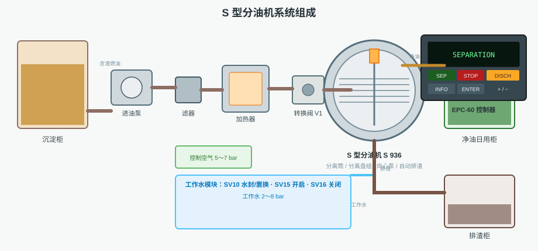
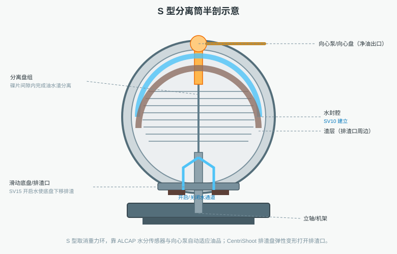
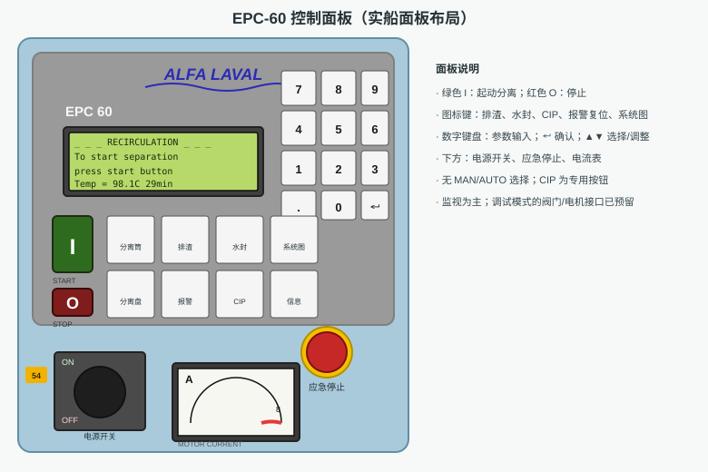
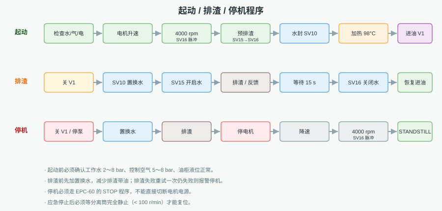
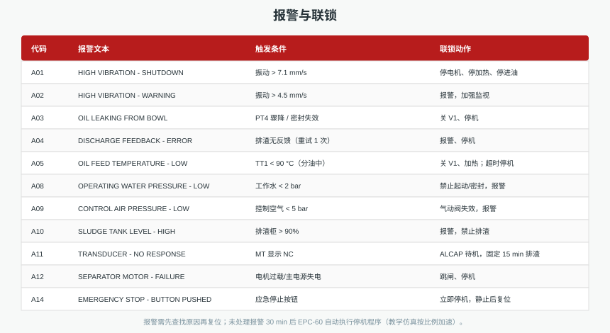
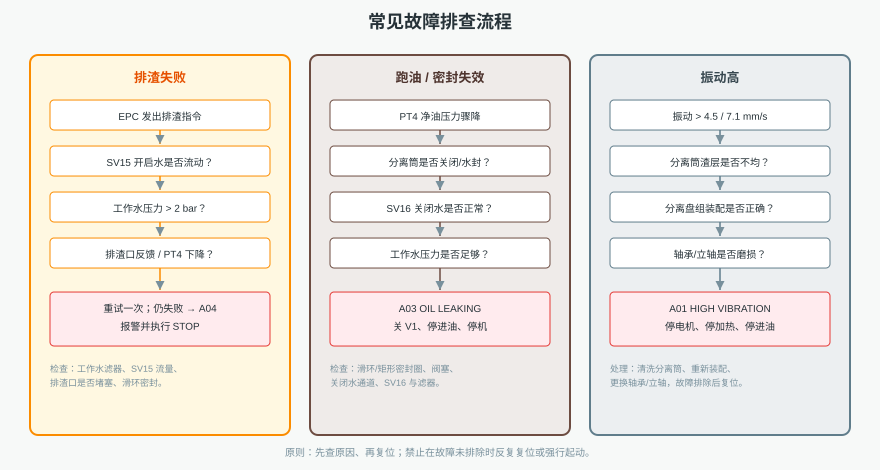

# 分油机自动控制操作程序及故障处理

> 本文配合本仿真软件使用：第 1 页为“分油机运行状态”，第 2 页为“S 型分油机系统与机旁控制”，第 3 页为“EPC-60 面板与系统模拟图”（左侧 EPC-60 面板，右侧 P&ID 风格系统模拟图）。建议同步打开软件，按文中顺序操作对照。

## 一、分油机的作用与 S 型结构

船舶燃油分油机利用高速旋转产生的离心力，把燃油中的水分和机械杂质分离出来，保证进入主机和发电机的燃油清洁。S 型分油机以 Alfa Laval S 936 为原型，主要由机架、电机、摩擦离合器、立轴、分离筒、分离盘组、向心泵（向心盘）、滑动底盘、排渣口和工作水系统组成。

与常见的 P 型相比，S 型有三个显著特点：取消重力环，靠 ALCAP 水分传感器自动适应油品密度和粘度；采用向心泵/向心盘把净油从分离筒中心引出；采用 CentriShoot 排渣盘，靠工作水压使排渣盘弹性变形，瞬时打开排渣口。S 936 的分离筒额定转速约 10680 r/min，电机功率约 7.5 kW，起动时间约 2～5 min，停机时间约 15～30 min。

## 二、EPC-60 控制器与面板

EPC-60 是 PLC 型分油机控制器，采用 LCD 文本菜单，支持“一键起动/停止”，自动控制水封水、置换水、开启水和关闭水，并根据净油出口的水分传感器自动决定“开排水阀”还是“排渣”。

面板主要按键：绿色 `I`（起动）、红色 `O`（停止）、排渣图标键、红色三角（报警确认/复位）、`i`（运行信息）、`↵`（进入/保存）、`▲` / `▼`（选择/调整）、数字键盘 `0~9`、`.`、`⌫`；`CIP` 有专用按钮。面板下方还有电源开关、应急停止蘑菇按钮和电流表。

## 三、自动起动与分油

1. **起动前检查**：工作水压力 2～8 bar，控制空气 5～8 bar，油柜液位正常，管路阀门位置正确；机旁主电源合上，机旁/遥控开关置“遥控”。
2. **EPC-60 上电**：合上电源钥匙，模式旋钮置 `AUTO`，按 `SEPARATION`。
3. **升速**：电机经摩擦离合器和皮带带动分离筒升速；约 4000 r/min 时 EPC-60 令 `SV16` 短暂开启，保持分离筒关闭。
4. **预排渣与水封**：达到额定转速后，先 `SV15` 开启水做一次预排渣，清除上次残留；再 `SV16` 关闭分离筒，`SV10` 建立水封。
5. **加热与进油**：加热器把燃油升到约 98 °C（滑油约 95 °C），温度达到设定值后自动开 `V1`、起动进油泵，进入 `SEPARATION`。
6. **正常分油**：ALCAP 连续监测净油水分；水分高时先开排水阀 `V5`，若持续偏高则提前排渣。

## 四、自动排渣与停机

排渣程序：关进油阀 `V1` → `SV10` 加置换水把筒内净油赶出 → `SV15` 开启水使滑动底盘下移、排渣口打开 → 等待约 15 s → `SV16` 关闭水关闭分离筒 → `SV10` 补水封 → 恢复进油。排渣前加置换水，是为了减少排渣时随渣排掉的油损失。

停机程序：按 `STOP` 后，EPC-60 自动关 `V1`、停进油泵和加热器，加置换水、排渣，再停电机；转速降到约 4000 r/min 时 `SV16` 脉冲保持筒体关闭，完全静止后显示 `STANDSTILL`。停机必须走 EPC-60 程序，不能直接切断电机电源。

## 五、报警与故障处理

常见报警：振动高（A01/A02）、跑油（A03）、排渣失败（A04）、油温低（A05）、工作水压力低（A08）、控制空气低（A09）、排渣柜高（A10）、水分传感器故障（A11）、电机故障（A12）、应急停止（A14）。

处理原则：先查原因，再按 `ALARM RESET` 确认、复位；故障未排除时反复复位没有意义。排渣失败重点查工作水滤器、`SV15` 流量、排渣口和滑环密封；跑油重点查分离筒关闭水、矩形密封圈和阀塞；振动高重点查渣层不均、分离盘组装配、轴承和立轴。

## 六、操作要点

- 起动前先确认工作水、控制空气和油柜液位，避免带故障起动。
- `AUTO` 模式下阀门由 EPC-60 控制；需要单独动作阀门时切到 `MAN`，并注意联锁。
- 排渣间隔、分离温度、进油流量等参数应结合油品和实际工况设定；排渣间隔过短会增加油损失，过长会使渣空间充满、分离效果下降。
- 应急停止后必须等分离筒完全静止（转速 < 100 r/min）才能复位；重新起动前必须查明原因。
- 仿真默认按 1× 实时运行；需要快速演示时，可在 EPC-60 参数菜单把「仿真时间倍率」调到 5× 或 10×。
