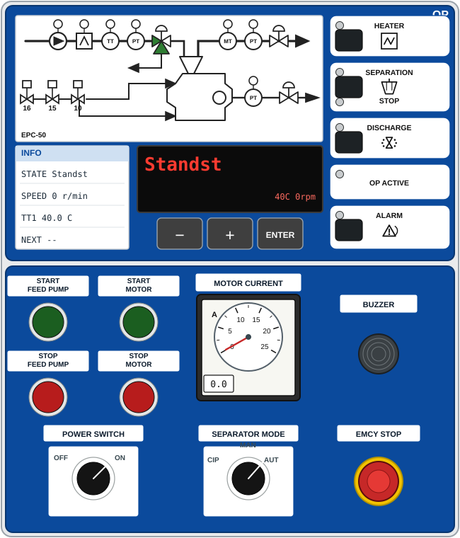
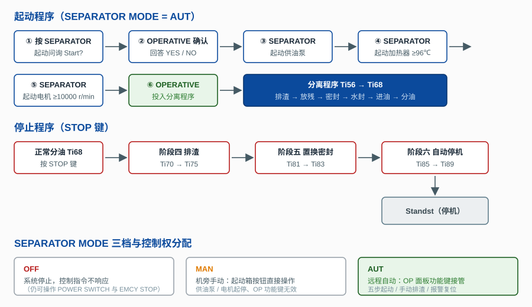

# 分油机自动控制系统的功能测试

> 船舶 S 936 型分油机 + **Alfa Laval EPC-50 控制器**（OP 操作面板 + 电机起动控制箱）仿真教学工程。
> 工程为**单页仿真**：画布同屏只有 EPC-50 控制器与分油机系统模拟图两台设备（等高并列）。

## 一、EPC-50 控制器是什么

EPC-50 是 Alfa Laval 为 S / P 型分油机配套的电子程序控制器（1999 年推出，2010 年停产，
现已被 EPC-70 取代）。一套 EPC-50 系统由三部分组成：

| 单元 | 作用 |
|------|------|
| **OP 操作面板**（Front Module 前端模块） | 装在集控室操作台：流程图状态灯、INFO 信息区、液晶显示器、−/+/ENTER 软键、6 只功能键 |
| **I/O 单元** | 采集 PT/TT/MT/转速/振动信号，驱动 SV1/SV4/SV5/SV10/SV15/SV16 等电磁阀与 V1/V4/V5 |
| **电机起动控制箱** | 供油泵与电机的起停按钮、电机电流表、SEPARATOR MODE 与 POWER SWITCH 旋转开关、蜂鸣器、应急停止 |

本工程把 **OP 操作面板与电机起动控制箱合并为一个仿真组件**（`components/EPC50Controller.js`），
控制逻辑参照后继机型 EPC-60（见 `tools/PurifierSolver.js`），通过 Ti 定时器驱动全部分离程序。

## 二、OP 操作面板

- **流程图（左上）**：8 只状态灯依次为供油泵 T1、加热器 T2、三通阀 V1 供油位 M1、回油位 M2、
  净油出口阀 V4、分离筒、控制空气与报警；下方 1/2/3 为工作水阀组 SV10/SV15/SV16。
- **INFO 信息区（左下）**：状态、分离筒转速、TT1 进油温度、到下次排渣的剩余时间。
- **液晶显示器**：黑底红字。停机 `Standst`、起动 `Start`、起动序列 `Startseq`、
  分油 `Separat`、排渣 `Discharg`、停机 `Stop`；右侧小字显示当前 Ti 定时器与剩余时间。
- **− / + / ENTER 软键**：菜单中移动光标与增减参数值；起动问询画面中 ± 切换 YES / NO，
  ENTER 确认。按 ENTER 进入主菜单（参数设置 / 时间设置 / 报警记录 / 操作信息 / 返回主画面）。
- **6 只功能键**（每只键上方带状态灯）：
  HEATER（加热器投切）、SEPARATOR（起动）、STOP（停止程序）、
  DISCHARGE（手动排渣）、OPERATIVE（投入运行）、ALARM（报警确认与复位）。

## 三、电机起动控制箱

- **START FEED PUMP / STOP FEED PUMP**：供油泵起停（带运行指示环）。
- **START MOTOR / STOP MOTOR**：分油机电机起停（STOP MOTOR 走正常停机程序，不硬切电机）。
- **MOTOR CURRENT**：0~25 A 电流表，18 A 以上为过载红区；正常分油电流约 14 A。
- **SEPARATOR MODE**：三档 —— 左 60° CIP（清洗位，本仿真不实现）、垂直向上 MAN（机旁手动）、右 60° AUT（远程自动）。
- **POWER SWITCH**：OFF / ON，合闸时主回路与 EPC-50 面板同时得电。
- **BUZZER**：报警时鸣响，按一下确认报警。
- **EMCY STOP**：应急停止，按下后电机、供油泵、加热器与各电磁阀全部断电。

## 四、控制逻辑

### 4.1 控制权分配

| SEPARATOR MODE | 控制权 | 可用操作 |
|----------------|--------|----------|
| CIP（左 60°） | 无 | 清洗位，本仿真不实现；仅 POWER SWITCH 与 EMCY STOP 可用 |
| MAN | 机旁手动 | 起动箱四只按钮；OP 功能键无效 |
| AUT | EPC-50 远程自动 | OP 六只功能键；起动箱按钮无效 |

### 4.2 起动（五步）

AUT 位下按 **SEPARATOR** 键依次推进：**① 起动问询 → ② 供油泵 → ③ 加热器（≥96 ℃）
→ ④ 电机（≥10000 r/min）**，最后按 **OPERATIVE** 投入分离程序（Ti56 → Ti68）。

### 4.3 停机

按 **STOP** 键：阶段四排渣（Ti70~Ti75）→ 阶段五置换与密封（Ti81~Ti83）
→ 阶段六自动停机（Ti85 停电机 → Ti86 降速 → Ti87 停泵 → Ti89 静止）→ `Standst`。

## 五、仿真操作

1. 在系统模拟图上打开沉淀柜出口阀、回流阀、蒸汽截止阀、控制空气进口阀、工作水进口阀。
2. 在 EPC-50 控制器上把 POWER SWITCH 合闸 **ON**，SEPARATOR MODE 顺时针打到 **AUT**。
3. 按 **SEPARATOR** → **OPERATIVE** → **SEPARATOR**（供油泵）→ **SEPARATOR**（加热器）
   → **SEPARATOR**（电机）→ **OPERATIVE**（投入分离程序），液晶屏逐条显示 Ti 步骤。
4. 手动排渣按 **DISCHARGE**；停机按 **STOP**；报警按 **ALARM** 或点击蜂鸣器确认。
5. 工具栏「故障设置」可注入分离筒密封失效、水分传感器故障、分油温度低、振动高、
   排渣失败、工作水压力低、电机过载七种故障，观察报警与自动停机。

## 六、教学流程（工作流面板）

| 流程 | 内容 |
|------|------|
| 1. 分油机系统的认识 | 认识系统模拟图：SV1/V1/SV4/V5/SV10/SV15/SV16、PT1/PT4/PT5/TT1/MT/ST 与分离原理 |
| 2. EPC-50 控制器的认识 | 逐件识别 OP 面板与电机起动控制箱上的 36 个可点击部件 |
| 3. 分油机的起动和停机 | 完整走一遍开阀 → 上电 → 远程接管 → 五步起动 → 手动排渣 → 停机 |
| 4. 分油机故障的处理 | 注入密封失效、传感器故障、温度低等故障并按报警提示处理复位 |
