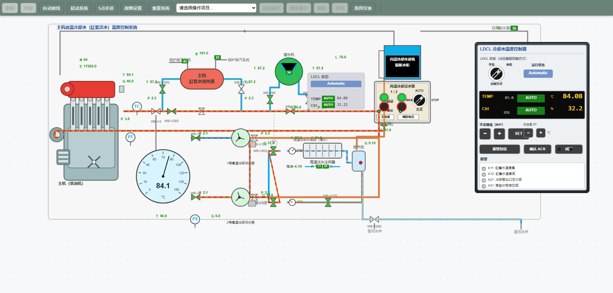
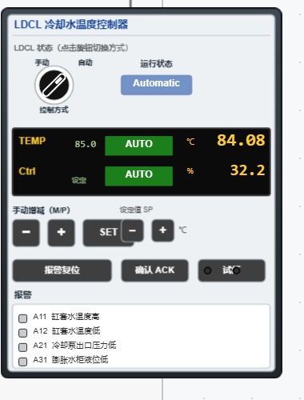

# 冷却水温度控制系统的功能测试

> 工程：`lab_10/syy51_ljzdh83`（项目配置 `project/sys_ljdq8-9.js`）
> 依据：冷却水系统图（`船舶冷却水系统MIMIC图.svg` / `冷却水系统图.png`）

主机运行时约 30 % 以上的热量由**缸套淡水（高温冷却水）**带走：热量过多，缸套与缸头热应力增大、润滑油膜变薄；热量过少，缸套低温腐蚀与热效率下降。因此缸套水出口温度必须稳定在设定值（本系统 85 ℃ 左右）附近。

## 一、系统组成

| 设备 / 元件 | 图中的代号 | 作用 |
|---|---|---|
| 主机（柴油机） | — | 缸套、缸头放出的热量由缸套水带走 |
| 温度变送器 | TC（T 84.x） | 测量缸套水出口温度，作为控制的反馈量 |
| 1#、2# 高温冷却淡水泵 | 1 / 2 起动·停止（WB-V8/9、WB-V10S/11S） | 一用一备，提供冷却水循环动力；PS 水流开关监视水流 |
| 高温淡水冷却器 | WB-V502 支路 | 缸套水在此被**低温冷却水（海水）**冷却 |
| 冷却水调节阀 | Ctrl（WB-V12S / WB-V502 处） | 改变"经冷却器"与"旁通"的份额，是温度控制的手段 |
| 除气柜、膨胀水柜 | —（L 78 %） | 除气、容纳膨胀量并补水，保证循环稳定 |
| 缸套水加热器 | WB-V25S / WB-V27S（锅炉蒸汽） | 冷机起动前预热、低负荷保温 |
| 造水机 | WB-V6S / WB-V7S（34） | 用缸套水余热加热海水制淡 |
| LDCL 冷却水温度控制器 | TEMP / Ctrl / Automatic | 采集 TC，按设定值调节冷却水调节阀 |

## 二、控制原理

缸套水温度由**经冷却器的冷却水量**决定。调节阀（Ctrl，0~100 %）表示旁通阀开度：

- Ctrl 增大 → 更多缸套水绕过冷却器 → 带走热量减少 → 温度**上升**；
- Ctrl 减小 → 更多缸套水经冷却器 → 温度**下降**。

控制器为"负荷前馈 + PI + 积分分离"的温度定值控制：TEMP 行显示 TC 实测温度，偏差越大越快反向修正；偏差过大时切除积分（防止积分饱和），偏差小时由积分作用消除余差（本系统 84~85 ℃ 稳态误差 < 0.3 ℃）。主机负荷增大时，缸套水温度有升高趋势，控制器自动把 Ctrl 调小，让水温回到设定值。

控制器面板：方式旋钮（Automatic / Manual）、TEMP 行（AUTO 自动 / MANU 手动）、Ctrl 行（AUTO / MANU）、M/P 手动增减、SET、SP ±、报警复位 / 确认 / 试灯，以及 A 11 / A 12 / A 21 / A 31 报警灯。

## 三、报警与联锁

| 报警 | 条件 | 处理要点 |
|---|---|---|
| A 11 缸套水温度高 | 出口温度 > 设定值 + 10 ℃（持续 3 s） | 检查调节阀、冷却泵与海水温度；持续过高应减负荷 |
| A 12 缸套水温度低 | 出口温度 < 设定值 − 10 ℃ | 检查调节阀开度、补水；低负荷时可投缸套水加热器 |
| A 21 冷却水泵出口压力低 | 泵运行时出口压力 < 1.8 bar | 切换备用泵，检查吸入阀与滤器 |
| A 31 膨胀水柜液位低 | 液位 < 20 % | 查漏并补水，随后复位 |

**主机保护**：两台冷却泵全停或出口压力低于 0.3 bar 持续约 5 s，水流开关 PS 断开，主机自动停车；同时由于冷却水中断，缸套水温度持续上升，最终触发 A 11。

## 四、功能测试（对应四个操作项目）

1. **系统的组成与认识**：识别主机、TC、两台冷却泵、冷却器与调节阀、除气柜、膨胀水柜、加热器、造水机等部件与控制器面板。
2. **手动操作**：控制方式置 Manual → 开吸入阀 → 起泵 → 开冷却器 / 旁通 / 除气柜 / 膨胀水柜阀门 → 用 M/P 键改变 Ctrl，观察温度随开度变化（约 0.3 ℃/%）。
3. **自动控制**：两台泵起动、方式打 Automatic，TEMP 行切 AUTO；改设定值到 84 ℃观察 Ctrl 调节与温度跟随；主机负荷 64 % → 85 % 后温度自动回到设定值。
4. **故障处理**：1# 泵电机故障（2# 泵维持供水）、TC 变送器故障（TEMP 显示 `***`，自动调节切除保持当前开度）、阀卡涩、控制器故障、膨胀水柜泄漏（A 31）；两台泵全停观察主机保护停车与 A 11。
