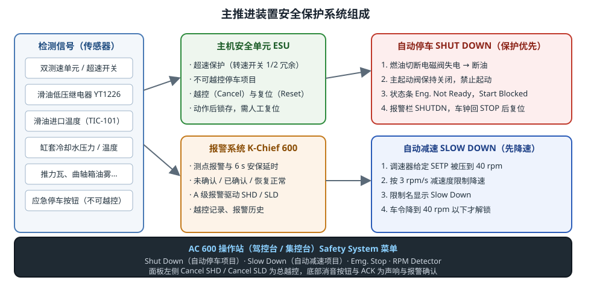
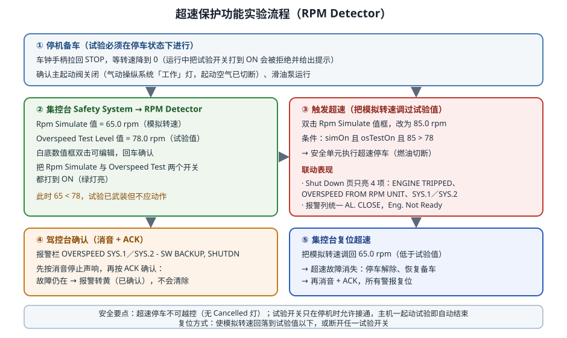
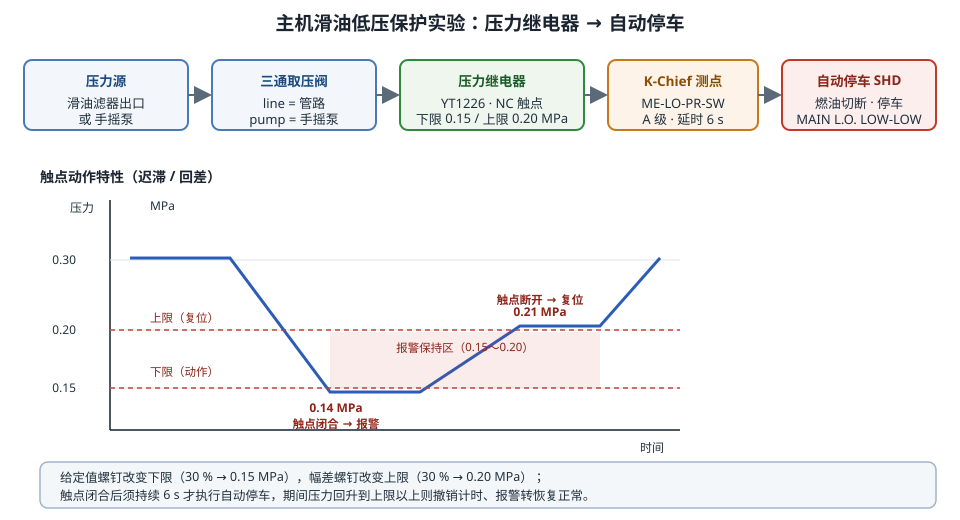

# 主推进装置的安全保护功能测试

船舶主推进装置（主机）一旦出现超速、滑油低压、冷却水断流等危及机器本身的故障，必须在运行人员来不及处置的极短时间内自动使主机降速甚至停车。本仿真以 MAN B&W AutoChief 600 主机遥控系统与 K-Chief 600 报警系统为原型，用于训练学员**安全保护装置的操作、越控与复位**，以及超速、滑油低压两项保护功能实验。

操作站在驾控台与集控台上均设有 Safety System 菜单，二级菜单包括 **Shut Down（自动停车项目）**、**Slow Down（自动减速项目）**、**Emg. Stop（应急停车）** 与 **RPM Detector（转速检测）**；面板左侧为总越控按钮 Cancel SHD / Cancel SLD / Cancel Limits，底部为消音按钮与 ACK 确认按钮。

## 一、主机安全保护功能介绍

### 1. 系统组成与等级

安全保护分为三级，按危害程度递进：**报警 → 自动减速 → 自动停车**。检测信号来自双测速单元、滑油压力继电器、冷却水温度与压力、推力瓦温度等；主机安全单元（ESU）负责动作与锁存，报警系统（K-Chief 600）负责测点报警、延时判定与记录；二者共同驱动燃油切断电磁阀与调速器给定，任何一处动作，操作站上均同步显示。

按可否越控又分为两类：

| 类型 | 典型项目 | 能否越控 |
|---|---|---|
| 不可越控停车 | 超速（RPM UNIT、SYS.1/SYS.2）、EICU 不可越控停车、应急停车开关 | 无 Cancelled 灯，**不能**越控 |
| 可越控停车/减速 | 滑油低低压、缸套水进口低压、推力瓦高温、滑油/缸套水温度高、振动、油雾浓度高等 | 有 Cancelled 灯，**可以**逐项或整页越控 |

### 2. 自动停车（Shut Down）

项目动作时：燃油切断电磁阀失电断油 → 主机停车 → 状态条显示 Eng. Not Ready、起动受阻（Start Blocked）→ 报警栏出现 `SHUTDN` 信息，Shut Down 页对应行 Active 灯亮红。**停车动作是锁存的**：即使故障恢复，也须在确保故障已排除后，由拥有控制权的操作位置把车钟手柄拉回 STOP，并配合 Cancel SHD（越控时）才复位、恢复备车。

### 3. 自动减速（Slow Down）

项目动作时：调速器给定 SETP 被限制到 40 rpm，主机按减速度限制（3 rpm/s）降速，主页显示限制名 `Slow Down`。减速动作同样锁存，**只有把车令拉回到 40 rpm 以下才解除**，不会自行恢复。越控 Cancel SLD 只对"尚未真正减速"的情况有效（取消本次减速与预报警）；已经减速成功后取消越控不能马上提速。

### 4. 越控（Cancel）与复位

- **逐项越控**：在 Safety 页点选某一行，该行右侧出现 `Cancel SHD / Cancel SLD` 按钮，按一次越控该故障（Cancelled 灯变红、行转橙色），再按一次还原。
- **总越控**：按面板左侧 Cancel SHD / Cancel SLD，把本页**所有可越控项**一次性越控；再按一次全部还原。越控本身会产生报警 `SHUTDOWN/SLOWDOWN CANCELLED, ACTIVE`，需要应答。
- **消音与确认**：消音只停止声响；ACK 让报警由"未确认（红）"转"已确认（黄）"；故障消失后已确认的报警自动清除，未确认的转为恢复正常（RTN），仍须 ACK 才清除。

## 二、超速保护功能实验

**实验条件**：主机必须处于**停机**状态（试验开关在运行中会被拒绝）。先在驾控台把车钟拉回 STOP，等转速降到 0；在气动操纵系统页确认主起动阀关闭；在滑油系统页确认滑油泵运行。

**操作步骤**（在集控台完成）：

1. Safety System → **RPM Detector**，进入转速检测页。白底数值框可双击编辑、回车确认。
2. `Rpm Simulate` 设为 **65.0 rpm**，`Overspeed Test Level` 设为 **78.0 rpm**，此时模拟转速低于试验值，属"已武装、不动作"。
3. 把 `Rpm Simulate` 与 `Overspeed Test` 两个开关都打到 **ON**（绿灯亮）。
4. 把 `Rpm Simulate` 改为 **85.0 rpm**（高于 78），满足"两开关 ON 且模拟转速 > 试验值"，安全单元立即执行**超速停车**。
5. 回驾控台观察：报警栏两条 `OVERSPEED SYS.1／SYS.2 - SW BACKUP, SHUTDN`；Shut Down 页只有 4 项点亮（ENGINE TRIPPED、OVERSPEED FROM RPM UNIT、SYS.1、SYS.2），报警列统一 `AL. CLOSE`，状态条显示 Eng. Not Ready。先**消音**再按 **ACK**，因故障仍在，报警转黄。
6. 回集控台把 `Rpm Simulate` 调回 **65.0 rpm**（低于试验值），超速故障随之消失：停车解除、恢复备车；再消音 + ACK，报警全部清除。

**要点**：超速项**不可越控**，只能靠转速回落到试验值以下（或断开任一试验开关）使故障消失；试验开关只在停机时允许接通，主机一起动试验自动结束。真实船舶还会用超速试验旋钮模拟转速信号，原理相同。

## 三、主机滑油低压保护实验

**信号链**：滑油压力 → 三通取压阀 → 压力继电器 YT1226 → NC 触点 → K-Chief 测点 `ME-LO-PR-SW`（A 级，安保延时 6 s）→ 自动停车。

压力继电器的**下限（动作值）** 由给定值螺钉设定（30 % → 0.15 MPa），**上限（复位值）** 由幅差螺钉设定（30 % → 0.20 MPa）。压力低于下限时 NC 触点**闭合**（输出 1，报警）；压力升到上限以上才重新**断开**（输出 0）。两者之间为报警保持区，避免压力在设定点附近抖动反复报警。

**操作步骤**：

1. 在主机滑油系统页把压力开关的三通取压阀切到**手摇泵**输出（模拟滑油压力下降）。
2. 按 ▼ 把手摇泵压力逐次降到 **0.14 MPa**：压力低于下限 0.15 MPa，NC 触点闭合，测点报警。
3. 回到驾控台：6 s 安保延时到点后主机**自动停车**，报警 `MAIN L.O. LOW-LOW PRESS, SHUTDN`，Shut Down 页出现 `MAIN L.O. LOW-LOW PRESS` 行，状态条 Eng. Not Ready；消音 + ACK 确认。
4. 回到滑油页把压力升到 **0.21 MPa**（越过复位上限 0.20 MPa）：触点断开、报警转为恢复正常；把三通阀切回滑油管路。
5. 回驾控台把车钟手柄拉回 **STOP**，自动停车复位：报警清除、备车恢复（Eng. Ready），主机可重新起动。

**要点**：若压力在**延时 6 s 内**回升到上限以上，计时立即撤销，报警转恢复正常，**不会**触发停车——这体现了"延时判定"对瞬时波动与真实故障的区分；压力开关的上下限与幅差直接决定保护动作点，实验中可通过螺钉调节进行验证。

## 四、实验注意事项

1. 安全保护动作一律**锁存**，任何"确认/消音"都不会让故障消失，必须消除故障源并按规定复位。
2. 越控是**临时管理手段**，不是修复手段；越控期间主机失去该项保护，须在轮机长指令下进行并记录。
3. 报警状态机遵循"未确认 → 已确认 → 恢复正常"：先应答后恢复的报警自动清除，先恢复未应答的报警仍须确认。
4. 所有实验应先在停机状态完成，确认备车条件（车钟 STOP、主起动阀关闭、滑油泵运行）后再动车钟。
