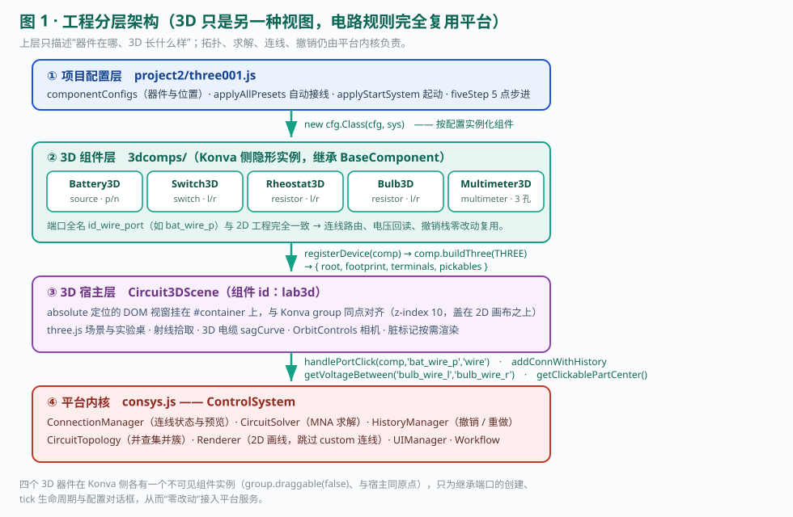
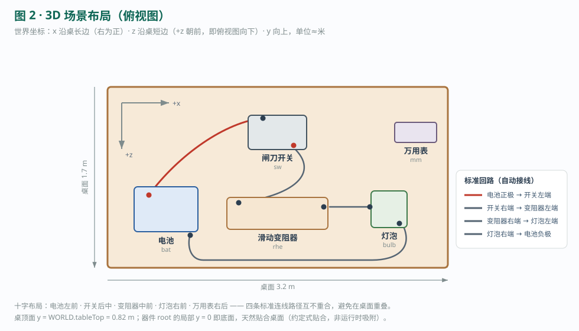
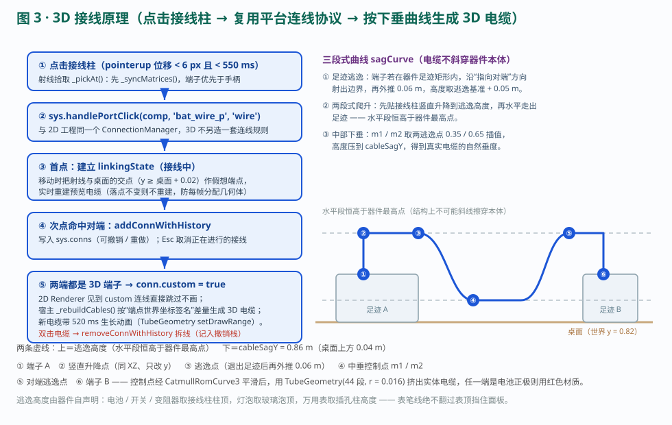
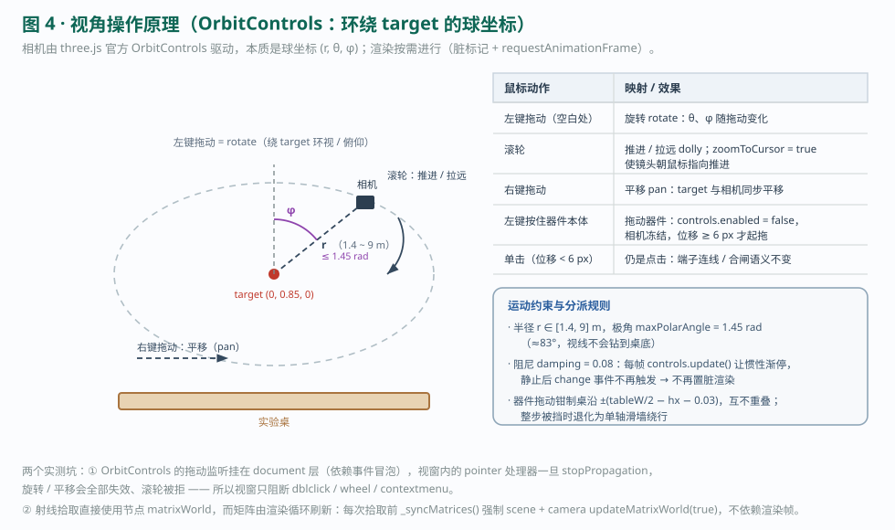
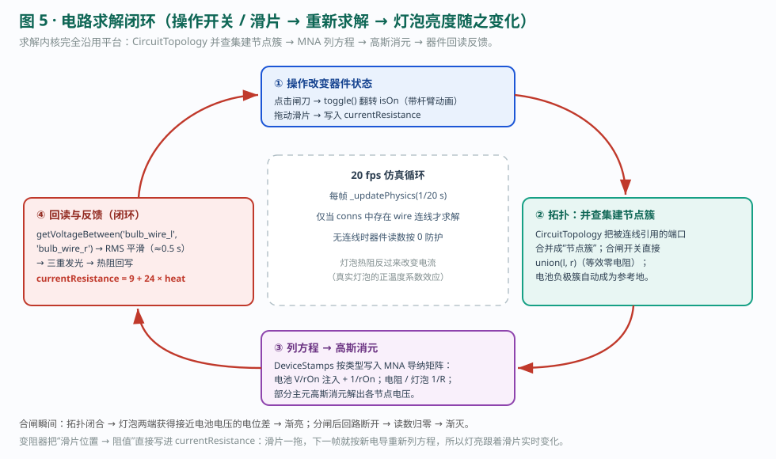

# 3D电路仿真基础

> 本文是对 `project2/three001.js` 工程（**001 简单3D电路的搭建**）的完整工作原理分析：从工程分层架构、3D 视窗与实验台的绑定方式，到电池 / 闸刀开关 / 滑动变阻器 / 灯泡四个 3D 组件各自的电气与视觉模型，再到"点击端口 → 动态生成 3D 电缆"与"鼠标视角操作"的实现机制，最后落到 20fps 电路求解闭环。

## 一、工程总览：Konva 平台之上嵌一块真 3D 视窗

本工程不使用 2D 画图模拟 3D，而是引入 **three.js（r187）** 渲染真正的 3D 场景；但求解内核、连线协议、撤销栈、仪表、配置对话框等全部沿用平台既有实现——3D 只是"另一种视图"，不另造一套电路规则。

| 文件 | 职责 |
|---|---|
| `3dcomps/world3d.js` | 世界常量 `WORLD`（唯一真相源）+ 电缆曲线 `sagCurve` + 文字贴图工具 |
| `3dcomps/Circuit3DScene.js` | 3D 宿主：DOM 视窗、three.js 场景、射线拾取、3D 电缆、相机控制 |
| `3dcomps/Battery3D.js` / `Switch3D.js` / `Rheostat3D.js` / `Bulb3D.js` | 四个 3D 电路组件（`buildThree()` 提供模型） |
| `project2/three001.js` | 器件布局、工具栏"自动接线/起动系统/5点步进"动作 |

四个 3D 器件在 Konva 侧各有一个不可见的组件实例（`group.draggable(false)`，与宿主同原点），意义在于继承 `BaseComponent` 的端口 / tick / 配置对话框生命周期，从而**零改动接入平台服务**：端口全名 `id_wire_port`（如 `bat_wire_p`）与 2D 工程完全一致，`ConnectionManager` 的 `linkingState`、拓扑并查机、`getVoltageBetween` 电压回读、撤销栈全部直接复用。

## 二、视窗绑定：3D 画布如何"长在"Konva 页面上

`Circuit3DScene._initViewport()` 在 `sys.stage.container()`（即 `#container`）内创建一个 `absolute` 定位的 `
`：`left/top` 取组件组坐标，宽高 = 组件尺寸 × 全局缩放系数（1920×1080 基准），`z-index:10` 盖在 Konva 画布上方；`WebGLRenderer` 画布挂进这个 div。提示条（legend）`pointer-events:none` 不挡交互。

three.js 侧：`PerspectiveCamera`（视场 40°）置于 `(2.9, 2.35, 3.35)` 俯视桌面；`WebGLRenderer` 像素比封顶 1.5、阴影 `PCFShadowMap` 且 `autoUpdate=false`（内容变化才重烘，`_invalidate()` 置 `needsUpdate`）；场景雾 `Fog(9, 24)` 远景渐隐。**渲染按需进行**：`_dirty` 脏标记 + `requestAnimationFrame` 循环——相机一动、动画一播、电缆一变才置脏，静止时零渲染。

## 三、3D 环境与实验桌：世界坐标里的"绑定"

世界坐标约定：x 沿桌长边、z 沿短边（+z 朝前）、y 向上，单位≈米。**器件与桌子、桌子与环境的"绑定"不是运行时吸附，而是一个共享常量表 `WORLD` + 约定式贴合**：

- 桌顶面高度 `tableTop = 0.82` 由 `WORLD` 统一给定；实验桌本体（`_buildEnvironment`）= 桌面 `Box(3.2, 0.08, 1.7)` + 四条腿 `Box(0.09, 0.74, 0.09)` 置于 `(±1.46, 0.37, ±0.72)` + 前后横撑；地面是 40×40 的平面加 16 m 网格，承接阴影。
- 任何器件"放在桌上" = 其模型根节点 `root.position.set(WORLD.xxx, WORLD.tableTop, WORLD.xxx)`——模型局部 y=0 即底面，天然贴合桌面顶面。
- 四器件按**十字布局**摆放（电池左、开关后中、变阻器前中、灯泡右），避免四根连线在桌面重叠；桌面上的"电池 / 闸刀开关 / 灯泡"铭牌（电池 / 闸刀开关 / 滑动变阻器 / 灯泡四块，标签宽度按器件自适应 `DEV_LABEL_W`）由 `makeTableLabel` 用 `CanvasTexture` 平铺在桌面上。

**器件 → 宿主的注册协议**：每个器件 `_init()` 里用 `hostId` 找到宿主并调 `registerDevice(comp)`；宿主调用 `comp.buildThree(THREE)` 拿到 `{ root, footprint, terminals, pickables }`：`root` 挂入 `_deviceRoot`（且 `root.userData.comp = comp` 供右键回溯）；每个端子的拾取柱登记进 `_portRegistry`（fullPort → 柱体、拾取盒、tip 偏移、Konva 端口节点）；器件足迹以**相对量**存入 `_compFp`，生成曲线/碰撞检查时按器件当前位置动态换算（`_fpFor`）——器件被拖走后电缆逃逸依然正确；开关手柄拾取盒登记进 `_pickSwitch`；反向写 `comp._host = this`。器件在 Konva 侧的端口锚点（隐藏小圆）由宿主每帧 `_syncPortCircles()` 用 `Vector3.project(camera)` 投影覆盖——2D 仪表接表笔时仍走端口协议。

## 四、五个 3D 组件的工作原理

**统一布局范式：`_recalcGeometry(config)`**。五个 3D 组件与复杂 2D 组件（如 `AmpMeter._recalcGeometry(config)`）采用同一套几何范式：构造函数里按固定顺序 `_initGroups() → _recalcGeometry(config) → 参数初始化 → _init()`，把**外形尺寸**（电池 `boxW/boxH/boxD`、开关 `baseW/baseD`、变阻器 `baseW/baseD`、灯泡 `plateW/glassR`、万用表 `caseW/caseD/caseH`，均可由 config 覆盖并钳制到安全区间）一次推算出 `_geo` 部件布局表——盒体/盖板/接线柱/识别环/铭牌、绝缘子/闸刀杆/夹口/手柄拾取盒、绕线管/滑轨/滑片、灯座/收口颈/玻璃/灯丝/点光，以及 `footprint`（足迹半尺寸+顶面）与端子 `tip` 偏移。`buildThree()` 只**消费** `_geo`，不再散落魔法数，因此"改一处尺寸、全身随动"，也不会出现部件与足迹对不上的穿模。它是纯计算、幂等可重跑；尺寸只在构造期生效（运行中改需整树重建模型，故不进右键参数框）。

### 4.1 电池 Battery3D —— `type='source'`

**电气**：直流电压源，Norton 等效注入求解内核——`getValue()` 返回电压（默认 3 V，右键可调 0.5–24 V），`rOn = 0.4 Ω` 为内阻；求解器自动把 source 负极簇钳位为**参考地**，因此本工程无需任何接地组件。
**视觉**：蓝色电池盒（`_geo` 推算，默认 0.6×0.34×0.42 m）+ 顶板，两根黄铜接线柱（±0.17, 0.415）带红/黑极性环；柱外套 r=0.065 的**透明拾取柱**（不可见但可被射线命中，扩大点击容差）；顶面"DC 3 V"铭牌由 `_drawTopLabel` 绘制 `CanvasTexture`，改电压实时重绘。

### 4.2 闸刀开关 Switch3D —— `type='switch'`

**电气**：触点电阻模型——`getValue()` 合闸返回 0（`CircuitTopology` 直接把 l/r 两端口**并簇**，等效零电阻），分闸返回 `Infinity`（按断路注入）。仅当两侧端口都接了线才参与并簇，所以接一半线不影响另一侧电位。
**交互与动画**：点击闸刀手柄 → `toggle()` 翻转 `isOn` 并设定 `_leverTarget`（合 0 / 分 0.92 rad ≈ 53°）；`tick(dt)` 里以 `diff × min(1, dt×14)` 的比例插值逼近目标角，旋转 `_lever` 完成抬起/落下的动画，角度变化超过 1e-6 时调 `host._invalidate()` 请求重绘。闸刀杆是铰接在左柱顶端的 `Group`（银杆 + 黑柄），合闸时杆头落进右柱夹口。
**拾取防冲突**：手柄拾取盒只罩杆的摆动区（y 0.24–0.70），端子拾取柱加高且在 `_pickAt()` 中**端子优先**——点到柱区域走接线，点到杆身才 toggle，两类点击互不误触。

### 4.3 滑动变阻器 Rheostat3D —— `type='resistor'`

**电气**：可变电阻，`currentResistance = rMin + (rMax − rMin) × sliderPos`（默认 1 Ω ~ 60 Ω，初始滑片 0.25 → 15.75 Ω）。滑片一动就把新阻值写进这个字段，求解器下一帧即按新电导重新列方程——所以“滑片一拖、灯光跟着变”。
**交互**：滑片拾取盒挂在 `_slideGroup` 下，`userData.kind='slider'`。宿主 `pointerdown` 里**滑片优先于整机拖动**：命中滑片就进入 `this._slide` 模式并临时 `controls.enabled = false`；`pointermove` 每帧把鼠标射线与“滑轨高度平面”（`slidePlaneY()`）求交，经 `worldToLocal` 换算成滑片比例（`dragSlider(worldPoint)`）；松手 `_endDrag()` 一并清除并恢复视角控制。滑片行程限制在绕线区两端，对应 `0 ~ rMax`。
**视觉**：底板 + 两端陶瓷支架 + 横置陶瓷管，管上 16 个铜色 `Torus` 绕线环代表电阻丝；管前上方一根黄铜滑轨，`_slideGroup`（滑块 + 支臂 + 触点 + 黑色捏手）整体平移表示滑片位置；两端黄铜接线柱即 `l` / `r` 端子。`fp.top` 取捏手顶部，保证电缆不会擦过滑片。
**内部接线（真实接法）**：两根接线柱并不直接搭在绕线两端，而是按实物焊好引线——左柱的引线绕过支架前侧接到陶瓷管左端的**绕线入口**（第一个绕线环处），右柱的引线竖直升起后接到上方**金属条（滑轨）右端**。于是电流路径 = 绕线（左端 → 滑片触点）+ 金属条（触点 → 右端）：滑片越往右，接入回路的绕线越长，`currentResistance` 随 `sliderPos` 线性增大的映射与实物一致。两根引线（`leadR = 0.008` 镀锡细管）与两端焊点都由 `_geo` 推算，走向避开支架与瓷管。

### 4.4 灯泡 Bulb3D —— `type='resistor'`

**电气**：电流路径电阻随灯丝温度变化——`heat = vRms / vRated`，`currentResistance = 9 + 24 × heat`（冷 9 Ω → 热 33 Ω）；该热阻每帧被求解器读走，**反过来影响电流**（真实灯泡的正温度系数效应）。
**热惯性**：`tick()` 用指数滑动平均 `_v2 += (v² − _v2) × 0.16` 求 RMS 电压（约 0.5 s 时间常数），所以合闸后灯泡是"渐亮"，分闸后"渐暗"，而非瞬间跳变。
**造型（真实灯丝）**：泡内灯丝不再是方块占位，而是一根**螺旋钨丝**——按 4 圈螺旋采样 96 点，用 `TubeGeometry` 沿曲线扫掠成丝（`filR = 0.17×glassR`、`filH = 0.62×glassR`、丝径 `max(0.0016, 0.018×glassR)`），两端再各引一根银灰**内引线**（`CatmullRomCurve3` 沿泡内壁下行、穿出玻璃底进颈部），还原真实灯泡的支架结构。所有尺寸仍由 `_recalcGeometry` 推算。
**烧毁**：`vRms > vBurn`（默认 6.5 V）持续 1.2 s → 灯丝烧断，三件事同时发生：① **电气**——`currentResistance` 置 1e9 Ω，回路断路；② **视觉**——完好螺旋丝隐藏，换成**两截断丝**（断口按采样点拉开约 8 mm、两截各向外张开 0.1 rad，断口端各留一颗熔珠鼓包），玻璃熏成暗灰、更通透（`opacity 0.42 → 0.30`），点光熄灭；③ 弹提示「重置系统」恢复。演示：把电池电压右键调大到 6.5 V 以上，且把变阻器滑片滑到最小（否则分压后泡端够不到 6.5 V）。
**视觉**：`_applyVisual()` 三重发光全部 in-place 更新：玻璃球自发光 `2.4×b`、灯丝 `4.6×b`（细丝需更亮才看得清）、点亮桌面的点光源 `7×b`（b = heat^1.4，指数压低低压时的微亮）。无连线/无求解时 `_measureVoltage()` 返回 0，不误亮。

### 4.5 万用表 Multimeter3D —— `type='multimeter'`

**电气**：端口 `ma` / `com` / `v` 与 2D 版同名，直接复用平台 `stampMultimeters` —— 电压档表内 10 MΩ 高阻、电阻/二极管档恒流源 + 顺从电阻、电流档在 mA–COM 间并 0.2 Ω 分流；求解器回填 `physCurrent`，表笔悬空（端口簇内没有其它端口）时不注入，读数按 `O.L` 处理。
**测量**：`tick()` 与 2D 版逐条对齐——DCV/ACV 取 `getVoltageBetween(v, com)`（交流取 40 点 RMS）、MA 读 `physCurrent`、RES 用 `R = |PD| / iSet`（RES200/RES2k/RES200k 分别 1 mA/0.1 mA/1 µA）、DIODE 判压降并低于 5 Ω 蜂鸣、C 用 1 mA 恒流充电斜率；模块级 `DIAL` 表定义 12 档的 `mode`、标签与指针角度。
**显示**：`update(val)` 节流 200 ms → 格式化（精度、k 换算、`O.L` 溢出）→ 写入 `_lcd` → 仅在内容变化时 `_paintLcd()` 重绘 640×256 画布（深墨绿底、荧光绿字，O.L 用橙红），再置 `tex.needsUpdate`；画布与贴图复用，不逐帧重建。
**交互**：旋钮拾取柱带 `userData.kind='knob'`，点击（260 ms 防抖）→ `nextMode()` 顺时针切下一档，指针 `rotation.z = −angle` 平滑转到新档位并弹档位提示。两处几何陷阱：① 插孔拾取柱不能过高（`hitH = 0.07`），否则俯视时先被“端子优先”的拾取规则抢走旋钮的点击；② LCD 平面必须高于屏框顶面（`lcdY = panelTop + 0.006`），否则整块屏被屏框盖成黑色。
**立式外形**：外壳默认 `caseW 0.36 / caseH 0.48 / caseD 0.14`（米）—— `caseH` 是**高度**，面板朝前（+z）、旋钮与插孔都在前面板上；面板元素按高度比例分布（LCD 在 `chh×0.74`、旋钮在 `chh×0.36`、插孔在 `chh×0.13`），所以调整 `caseH` 只拉长表体、不破坏面板自上而下的次序。

## 五、接线原理：点击端口 → 动态生成 3D 电缆

**点击判定**：`pointerdown` 记录起点，`pointerup` 时位移 < 6 px 且 < 550 ms 才算点击（拖动视角 / 拖动器件本体不算）。`_pickAt()` 先 `_syncMatrices()` 强刷世界矩阵，再用 `Raycaster` 从鼠标 NDC 坐标发射线，命中集合里**端子优先于手柄**。

**连线协议复用**：命中接线柱 → `sys.handlePortClick(comp, fullPort, 'wire')` —— 与 2D 工程同一个 `ConnectionManager`：首点建立 `linkingState`，此后 `_updateLinkPreview()` 每帧把射线与桌面平面的交点（y ≥ 桌面 + 0.02）作为假想端点，实时重建半透明预览电缆（落点不动则不重建，防每帧分配几何体）；次点命中对端柱 → `addConnWithHistory` 入 `conns`（可撤销）。Esc 取消。

**2D/3D 分工**：宿主 `tick()` 里 `_syncCables()` 发现某 wire 两端都登记在 `_portRegistry`（即都是 3D 端子）→ 打 `conn.custom = true`——2D 渲染层见到 custom 连线**跳过不画**，三维电缆由宿主按签名差量 `_rebuildCables()` 生成。

**电缆曲线 `sagCurve`（关键算法）**：解决"电缆斜穿器件本体"（先修好电池、再修灯泡玻璃的迭代教训）。每个器件申报 `footprint {hx, hz, top}`（底板/盒体半尺寸与顶面高度）；宿主以**相对量**存入 `_compFp`，生成曲线时按器件**当前位置**动态换算（`_fpFor`）——器件在桌上被拖动后，电缆逃逸与足迹依然正确。曲线生成分三段：

1. **足迹逃逸**：端子若在器件足迹矩形内（含 0.04 m 余量），沿指向对端的方向做 2D 射线求交，退出矩形后再外推 0.06 m，得逃逸点，高度 `max(a.y + 0.002, (fp.escapeY ?? fp.top) + 0.05)`；`fp.escapeY` 是**器件自声明**的基准高度，语义为“电缆从这个高度水平伸出不会撞到自己”：电池/闸刀开关/变阻器取接线柱柱顶（水平段越过同器件另一根柱），灯泡取玻璃泡顶（电缆从泡顶上方越过，不横穿玻璃球），万用表取插孔柱高度（表笔线自插孔水平伸出，绝不翻过表顶挡住面板）。未声明 `escapeY` 即退回 `fp.top`（结构最高点）。**教训**：早期用一条全局规则（一律 `fp.top + 0.05`，再强行 clamp 到端子 +0.06 m）无法两全——按顶面逃逸会让表笔线“翻过表顶”垂下来挡死面板，按端子逃逸又会让灯泡电缆横穿玻璃球；把逃逸高度的决定权交回器件（`escapeY`）后两种情形才能同时成立；
2. **两段式爬升**：控制点序列为 `[端子A, 竖直升降到逃逸高度, 逃逸点, m1, m2, 对端逃逸, 竖直下降, 端子B]`——先贴着接线柱竖直升降，再水平走出足迹。**水平段恒高于器件最高点**，"斜线擦穿本体"与"水平段穿过同器件其它接线柱"在结构上都不可能发生；
3. **中部下垂**：m1/m2 取两逃逸点的 0.35/0.65 插值、高度压到 `cableSagY = 0.86`（桌面之上），得到真实电缆的自然垂度。

八个控制点经 `CatmullRomCurve3` 平滑后用 `TubeGeometry(曲线, 44 段, r=0.016)` 生成实体电缆（castShadow 投影到桌面）；任一端是 `bat_wire_p` 则用红色材质（正极线约定）。新电缆带 520 ms **生长动画**（`setDrawRange` 从起点 ease-out 展开）。**双击电缆**：射线命中 `userData.kind==='cable'` 的电缆 → 反查 conn → `removeConnWithHistory` 拆线（撤销栈记录）。

## 六、鼠标视角 / 缩放的工作原理

相机由 three.js 官方 `OrbitControls` 驱动，本质是**环绕 target `(0, 0.85, 0)` 的球坐标** `(半径 r, 方位角 θ, 极角 φ)`：

| 操作 | 映射 |
|---|---|
| 左键拖动（空白/桌面） | `rotate`：θ/φ 随拖动变化（绕桌面环视、俯仰）；按下点在器件本体上时改为拖动器件（见下） |
| 滚轮 | `dolly`：r 增减 = 推进/拉远；`zoomToCursor=true` 使镜头朝鼠标指向推进 |
| 右键拖动 | `pan`：target 与相机同步平移 |

约束：r ∈ [1.4, 9] m、`maxPolarAngle = 1.45 rad`（≈83°，视线不会钻到桌底）、阻尼 0.08（每帧 `controls.update()` 让运动惯性渐停，静止后 `change` 事件停止触发、不再置脏渲染）。

**拖器件 vs 旋转视角的分派**：`pointerdown` 先对 `_deviceRoot` 射线探测——命中器件本体就记录 `_drag` 并立即 `controls.enabled = false`（OrbitControls 的 document 层 pointermove 因禁用而早退，**拖动期间相机冻结**）；位移 ≥ 6 px 才起拖（小位移松开仍是点击，端子连线 / 合闸语义不变）。拖动目标 = 射线与桌面平面的交点，抓取时记录偏移保证器件不跳位；桌沿钳制 `±(tableW/2 − hx − 0.03)`（前方给名称标签留位），器件间互不重叠——整步被挡时退化为单轴滑墙绕行。松开 `pointerup` → `_endDrag()` 恢复视角操作；端子投影、电缆曲线、名称标签全部实时跟随。

两个实测教训写进了代码注释：① OrbitControls 的拖动监听挂在 **document 层**（依赖事件冒泡），视窗内的 pointer 处理器一旦 `stopPropagation` 会让旋转/平移全部失效、滚轮被拒——所以视窗只阻断 `dblclick/wheel/contextmenu`；② 射线拾取直接使用节点的 `matrixWorld`，而矩阵由渲染循环刷新——后台标签页恢复、最初几帧等"未渲染态"会拾取全落空，因此每次拾取前 `_syncMatrices()` 强制 `scene + camera` 的 `updateMatrixWorld(true)`，不依赖渲染帧。

## 七、电路求解闭环：操作开关为什么能点亮/熄灭灯泡

平台的 20fps 仿真循环每帧执行 `_updatePhysics`：**仅当 `conns` 中存在 wire 连线才运行**求解（无连线不求解，器件读数按 0 防护）。求解分三步：

1. **拓扑**：`CircuitTopology` 用并查机把被连线引用的端口合并成"节点簇"；合闸开关直接 `union(l, r)`；
2. **列方程**：`DeviceStamps` 按类型把四器件写进 MNA 稀疏导纳矩阵——电池注入 `V/rOn` 电流源 + `1/rOn` 电导；变阻器与灯泡都注入 `1/currentResistance` 电导（变阻器阻值随滑片实时变化）；分闸开关注入断路大电阻；电池负极簇自动成为参考地；
3. **解方程**：部分主元高斯消元解出各节点电压。

随后 `Bulb3D.tick()` 用 `sys.getVoltageBetween('bulb_wire_l', 'bulb_wire_r')` 回读灯泡两端电压 → RMS 平滑 → 亮度三重发光 → **热阻回写**参与下一帧求解，构成闭环。合闸瞬间拓扑闭合、灯泡两端获得接近电池电压的电位差而渐亮；分闸后回路断开、读数归零而渐灭。工具栏"自动接线"一次接好四根标准线（电池 → 开关 → 变阻器 → 灯泡）；"起动系统"接线后自动合闸；"5点步进"则一根一根演示接线（四根）与合分闸过程，共 6 步循环（最后一步提示拖动滑片调亮度）。

> **工程隔离**：`consys.js` 中的冷却水过程模型按需创建——只有画布上存在 `type === 'cooling_water_mimic'` 的组件时才 `new CoolingWaterSolver(this)`，否则它会在本工程里空跑自己的主机保护逻辑并弹出无关报警。

## 八、参数实时配置与交互速查

**右键点击器件本体** → 宿主 raycast 命中后沿 `parent` 链回溯 `userData.comp` → 调平台 `showConfigDialog()`（输入框 `diag_<key>`，点「保存」→ `onConfigUpdate` 即时生效）：电池改电压并重绘铭牌、灯泡改额定/烧毁电压、变阻器改 rMin/rMax/滑片位置；开关无可调项会弹提示。右键点空白处也有操作引导提示。

| 鼠标动作 | 效果 |
|---|---|
| 点击接线柱 | 选线 / 成线（红线 = 电池正极线） |
| 点击闸刀手柄 | 合闸 / 分闸（带杆臂动画） |
| 点击万用表旋钮 | 顺时针切下一档（OFF → 二极管 → 电阻 → 电流 → 交流 → 直流 …） |
| 点击万用表插孔 | 选线 / 成线，表笔即 3D 电缆（v/com 测电压、ma/com 串入测电流） |
| 拖动变阻器滑片 | 改变回路电阻，灯泡亮度随之变化（拖动时视角冻结） |
| 双击 3D 电缆 | 拆除该线（可撤销） |
| 右键点击器件 | 打开参数设置 |
| 左键按住器件本体拖动 | 在桌面上移动器件（钳制桌沿、互不重叠） |
| 左键拖空白 / 滚轮 / 右键拖动 | 旋转 / 推进拉远 / 平移视角 |
| Esc | 取消正在进行的接线 |
